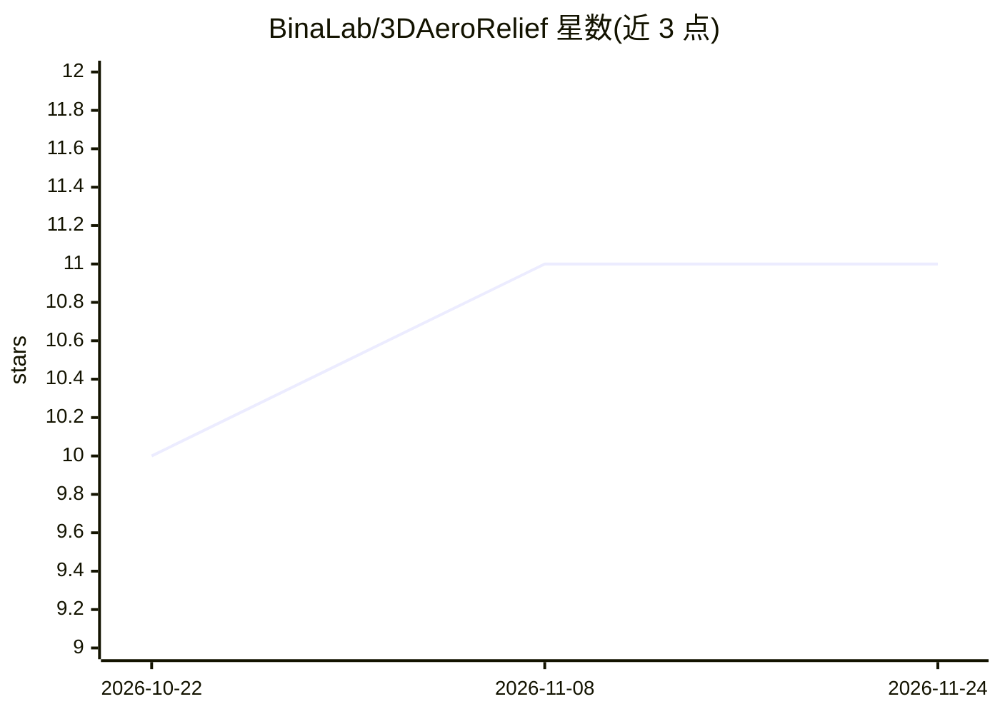

# BinaLab/3DAeroRelief

⭐ 11 · Python · 推送 2026-06-30 · [GitHub](https://github.com/BinaLab/3DAeroRelief) · 组织维护

**灾后评估的无人机 3D 点云语义分割基准数据集**

面向灾后场景语义分割的 3D 点云基准数据集，覆盖 8 个区域，点云标注为 5 类（背景、建筑受损/未受损、道路、树木）。GitHub 仓库提供 COLMAP 重建配置文件与 Python 工具脚本，用最近邻匹配将几何坐标与语义标签合并为可直接加载到 3D 学习框架的训练就绪 PLY 文件，并支持可视化输出与多进程并行处理。3D 数据经 Dropbox 外部托管，数据集采用 CC0 许可，附 arXiv 论文与 BibTeX 引用信息。

## 筛选速览

| 维度 | 判定 | 备注 |
|---|---|---|
| AI 角色 | `ai-knowledge` | 知识聚合/清单类 |
| 许可风险 | `none` | — |
| 部署形态 | `library` | 以包/库形式分发 |
| 模型依赖 | — | README 未给出锁定关系 |
| 硬件要求 | — | 无带数字的原话,不猜 |
| 安装摩擦 | `low` | 无编译、无系统依赖或容器化 |
| 成熟度 | — | 结构信号不足 |

## 能力要点

- 8 个区域的 RGB 3D 点云及语义标签，5 类灾后地物分类
- 提供用于重建的 COLMAP 配置文件
- Python 脚本将标签与几何合并为训练就绪 PLY，支持并行处理与可视化
- 数据集 CC0 许可，附 arXiv 论文引用

## 适用场景

- 训练和评测灾后场景的点云语义分割模型
- 建筑损毁评估相关研究
- 无人机摄影测量与多视图重建实验数据

## 场景标签

`目标检测` · 领域:感知与多模态

## 证据(README 行号)

> L7: 3DAeroRelief is a high-resolution 3D point cloud dataset designed to benchmark semantic segmentation algorithms in p
> L12: The 3D point cloud data (Areas 1-8) is available for download via Dropbox:

## 星数曲线

2026-10-22 10 → 2026-11-24 11（+1）

---
*卡片 v1 · prompt 1.4 · 生成 2026-11-19 · 置信度 mid · 依据 README sha `0213fb8ac4a0` · [字段定义](../../DATASET.md)*
