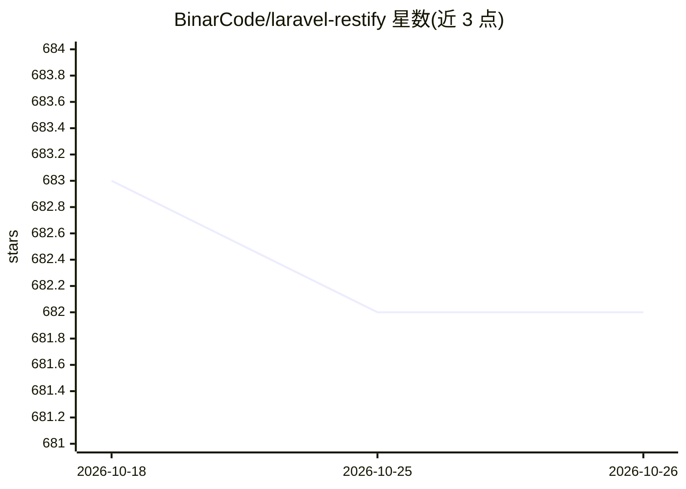

# BinarCode/laravel-restify

⭐ 682 · PHP · MIT · 推送 2026-10-24 · [GitHub](https://github.com/BinarCode/laravel-restify) · [官网](https://laravel-restify.com) · 组织维护

**Laravel API 框架：一套代码同时输出 JSON:API 与 MCP 接口**

面向 Laravel 开发者的 API 构建包：将 Eloquent 模型通过 Repository 定义自动生成为 JSON:API 端点与 MCP（Model Context Protocol）服务器，供人类开发者和 AI agent 共用；认证、授权策略与验证规则在两类接口下统一生效。支持搜索过滤、Laravel Sanctum 认证、自动生成 GraphQL schema，并附带开发期辅助包 Restify Boost（提供 MCP 文档访问与代码生成协助）。通过 composer 安装，MCP 启用为可选配置。

## 筛选速览

| 维度 | 判定 | 备注 |
|---|---|---|
| AI 角色 | `ai-ecosystem` | LLM/agent 周边工具 |
| 许可风险 | `permissive` | MIT |
| 部署形态 | `None` |  |
| 模型依赖 | — | README 未给出锁定关系 |
| 硬件要求 | — | 无带数字的原话,不猜 |
| 安装摩擦 | `low` | 无编译、无系统依赖或容器化 |
| 成熟度 | — | 结构信号不足 |

## 能力要点

- 单一 Repository 定义同时生成 JSON:API 端点与 MCP 工具定义
- Laravel policies 对人类与 AI 访问统一授权
- 支持搜索过滤、Sanctum 认证与自动 GraphQL schema
- Restify Boost 开发辅助包提供文档访问与代码生成协助

## 适用场景

- 为 Laravel 应用快速搭建 JSON:API 标准接口
- 让 AI agent 通过 MCP 安全访问已有业务模型
- 为 API 提供生产级启动模板（认证/权限/团队管理）

## 场景标签

`代码生成` · 领域:编码与开发

## 证据(README 行号)

> L10: Laravel Restify turns your Eloquent models into both JSON:API endpoints and MCP servers -- automatically. Build onc
> L24: - **MCP Server Generation** - Automatic AI agent interfaces with tool definitions

## 星数曲线

2026-10-18 683 → 2026-10-26 682（-1）

---
*卡片 v1 · prompt 1.4 · 生成 2026-10-21 · 置信度 high · 依据 README sha `b2260278f2b4` · [字段定义](../../DATASET.md)*
