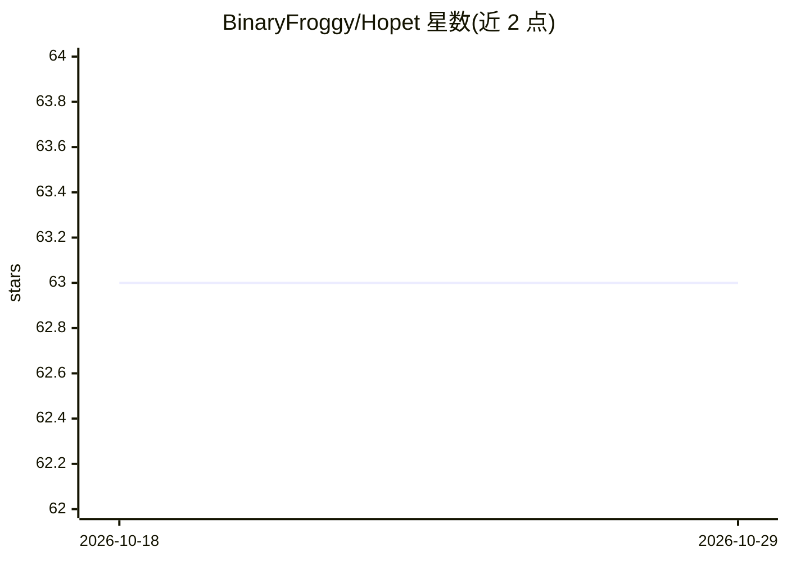

# BinaryFroggy/Hopet

⭐ 63 · Swift · MIT · 推送 2026-07-27 · [GitHub](https://github.com/BinaryFroggy/Hopet) · 个人维护 · 中文 README

**macOS 桌面 AI 宠物：实时显示 Claude Code / Codex CLI 会话状态**

SwiftUI + AppKit 编写的 macOS 桌面应用，面向使用 Claude Code 与 Codex CLI 的开发者。通过读写 ~/.claude/settings.json 与 ~/.codex/hooks.json 注册生命周期 hook，经 Unix Domain Socket IPC 接收 agent 事件，以像素宠物动画、气泡与灵动岛展示思考、工具执行、权限请求等 8 种状态，并可在桌面原位处理 Allow/Deny 与 AskUserQuestion 后经 socket 同步回传。限制：不支持浏览器版 Claude 及 Copilot Chat/Gemini CLI/Aider 等；当前 DMG 仅 Apple Silicon，Intel 需源码构建。

## 筛选速览

| 维度 | 判定 | 备注 |
|---|---|---|
| AI 角色 | `ai-ecosystem` | LLM/agent 周边工具 |
| 许可风险 | `permissive` | MIT |
| 部署形态 | `desktop` | 安装包/桌面程序 |
| 模型依赖 | — | README 未给出锁定关系 |
| 硬件要求 | — | 无带数字的原话,不猜 |
| 安装摩擦 | `low` | 无编译、无系统依赖或容器化 |
| 成熟度 | — | 结构信号不足 |

## 能力要点

- 8 态状态机覆盖 agent 会话生命周期，多 session 聚合取最高优先级状态
- 一键安装/卸载 Claude Code 与 Codex CLI hooks，非破坏性 JSON merge
- 权限请求与提问可在宠物气泡或灵动岛中直接处理并回传 agent
- 支持导入 8 张 GIF 或 Codex pet 格式主题包自定义宠物

## 适用场景

- 写代码时不用切回终端就能看到 AI agent 在做什么、是否需要我介入
- 多个 Claude Code / Codex 会话并行时一眼看清哪个在等权限或提问
- 在灵动岛或桌面宠物上直接批准权限、回答 agent 提问

## 场景标签

 · 领域:开发者工具/桌面应用

## 证据(README 行号)

> L22: Hopet 是一只常驻 macOS 桌面的 AI 编程宠物，它把 Claude Code / Codex CLI 的会话状态变成可见、可感知的桌面反馈：思考、执行工具、等待确认、请求权限、完成或失败，都能通过宠物动画、气泡提示和灵
> L32: Hopet 通过 agent CLI 的生命周期 hook 工作，目前覆盖以下 4 种用法：
> L41: 不支持：浏览器版 Claude（claude.ai）；以及非 Claude Code / Codex 的 AI agent（GitHub Copilot Chat、Gemini CLI、Aider 等）。

## 星数曲线

2026-10-18 63 → 2026-10-29 63（+0）

---
*卡片 v1 · prompt 1.4 · 生成 2026-10-24 · 置信度 high · 依据 README sha `fd430766f87a` · [字段定义](../../DATASET.md)*
