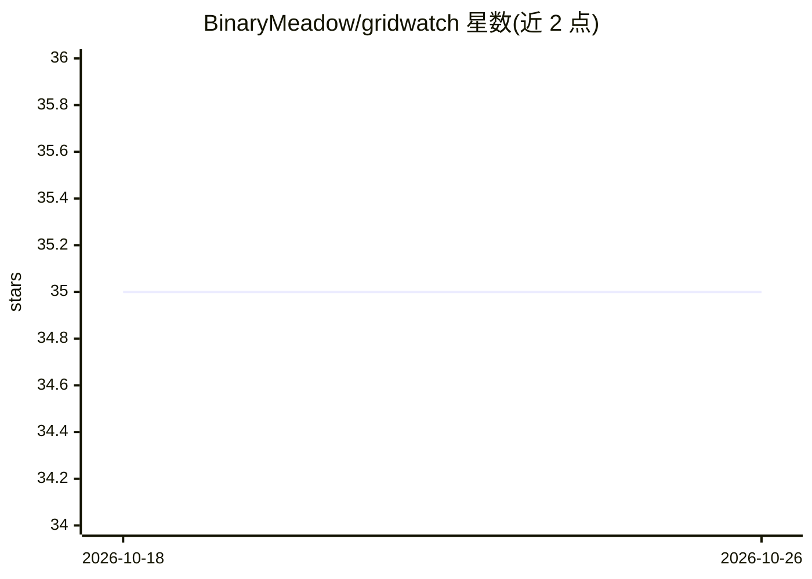

# BinaryMeadow/gridwatch

⭐ 35 · TypeScript · MIT · 推送 2026-09-03 · [GitHub](https://github.com/BinaryMeadow/gridwatch) · 个人维护

**桌面仪表盘：监控 GitHub Copilot CLI 会话与 token 用量**

Electron 桌面应用（Tron 主题），读取本地 ~/.copilot/ 下的会话数据与日志，以仪表盘形式浏览全部 Copilot CLI 会话：实时状态、token 用量图表与快照留存（抵御 Copilot 约 14 天日志清理）、上下文压缩跟踪、52 周活动热图、会话检索与标签、skills 管理与可视化编排生成、MCP/LSP 服务器面板、自定义 agents 查看。面向使用 Copilot CLI 的开发者；仅读取本地文件，网络请求限于更新检查与可选的 AI Insights。提供 macOS .dmg 与 Windows .exe 安装包。

## 筛选速览

| 维度 | 判定 | 备注 |
|---|---|---|
| AI 角色 | `ai-ecosystem` | LLM/agent 周边工具 |
| 许可风险 | `permissive` | MIT |
| 部署形态 | `desktop` | 安装包/桌面程序 |
| 模型依赖 | — | README 未给出锁定关系 |
| 硬件要求 | — | 无带数字的原话,不猜 |
| 安装摩擦 | `low` | 无编译、无系统依赖或容器化 |
| 成熟度 | — | 结构信号不足 |

## 能力要点

- 会话浏览、全文检索与 token 用量图表（快照留存抵御日志清理）
- skills 图谱、orchestrator 可视化编排并回写 SKILL.md
- MCP 服务器仪表盘（JSON-RPC tools/list 查询工具目录）与启停管理
- 压缩跟踪、研究报表明出、活动热图与自定义标签

## 适用场景

- 查看我所有项目的 Copilot CLI 会话历史与上下文用量
- 管理并编排我的 Copilot skills 与 MCP/LSP 服务器
- 分析提示词质量（可选的 AI Insights）

## 场景标签

`LLM 可观测性` · 领域:评测与运维

## 证据(README 行号)

> L3:  🖥️ A retro-Tron-themed desktop dashboard for monitoring your GitHub Copilot CLI sessions
> L9: GridWatch reads the local session data written by GitHub Copilot CLI to `~/.copilot/session-state/` and presents it 
> L33: - ◈ **MCP server dashboard** — view all installed Model Context Protocol servers (local stdio and remote HTTP), ena

## 星数曲线

2026-10-18 35 → 2026-10-26 35（+0）

---
*卡片 v1 · prompt 1.4 · 生成 2026-10-25 · 置信度 high · 依据 README sha `e19e2aa6cd99` · [字段定义](../../DATASET.md)*
