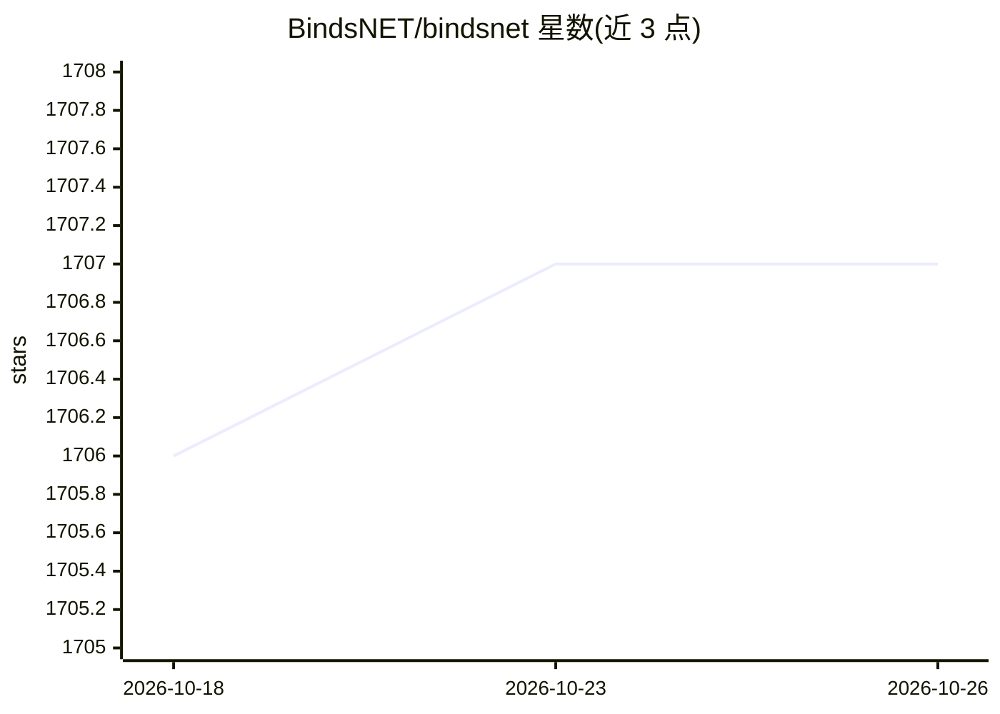

# BindsNET/bindsnet

⭐ 1,707 · Python · AGPL-3.0 · 推送 2026-10-23 · [GitHub](https://github.com/BindsNET/bindsnet) · 组织维护

**基于 PyTorch 的脉冲神经网络（SNN）仿真库，面向 ML/RL 研究**

Python 仿真库，用 PyTorch Tensor 在 CPU/GPU 上模拟脉冲神经网络，将描述神经元动力学的常微分方程转为差分方程按毫秒级时间步求解。支持 STDP 等突触可塑性学习规则（与论文方程逐一验证）、无监督/监督/强化学习示例脚本，强化学习环境内置 Gymnasium 与 ale-py。由 Tufts 大学 BINDS 实验室与 Allen Discovery Center 用于 SNN、ML 与 RL 研究。提供 pip、poetry 可复现安装与 Docker 镜像，不附带第三方数据集（由加载器从上游获取）。

## 筛选速览

| 维度 | 判定 | 备注 |
|---|---|---|
| AI 角色 | `ai-native` | 本体是模型或模型工具 |
| 许可风险 | `viral` | AGPL-3.0 |
| 部署形态 | `self-host` | docker 或自建部署 |
| 模型依赖 | — | README 未给出锁定关系 |
| 硬件要求 | — | 无带数字的原话,不猜 |
| 安装摩擦 | `low` | 无编译、无系统依赖或容器化 |
| 成熟度 | — | 结构信号不足 |

## 能力要点

- 基于 PyTorch Tensor 的 CPU/GPU 脉冲神经网络仿真
- STDP 等学习规则逐条对照源论文方程并附带测试
- 内置无监督/监督/强化学习（Atari Breakout）示例脚本
- 提供 poetry.lock 可复现安装与 Docker 镜像

## 适用场景

- 研究者实现和验证生物学启发的 SNN 学习算法
- 将 SNN 用于分类、聚类等机器学习任务
- 将 SNN 作为强化学习 agent 与 Gymnasium/Atari 环境交互
- 复现 Diehl & Cook 2015 等已发表论文结果

## 场景标签

`强化学习` · 领域:训练与推理

## 证据(README 行号)

> L1: A Python package used for simulating spiking neural networks (SNNs) on CPUs or GPUs using PyTorch `Tensor` functiona
> L3: BindsNET is a spiking neural network simulation library geared towards the development of biologically inspired algo
> L5: This package is used as part of ongoing research on applying SNNs, machine learning (ML) and reinforcement learning 

## 星数曲线

2026-10-18 1,706 → 2026-10-26 1,707（+1）

---
*卡片 v1 · prompt 1.4 · 生成 2026-10-21 · 置信度 high · 依据 README sha `fbd269b6928b` · [字段定义](../../DATASET.md)*
