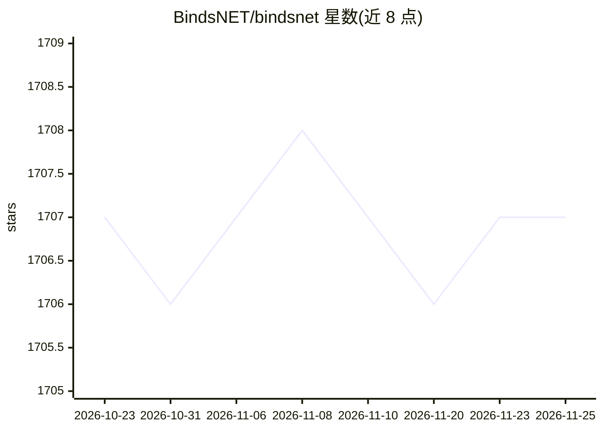

# BindsNET/bindsnet

⭐ 1,707 · Python · AGPL-3.0 · 推送 2026-11-23 · [GitHub](https://github.com/BindsNET/bindsnet) · 组织维护

**基于 PyTorch 的脉冲神经网络仿真库，面向 ML/RL 研究者**

BindsNET 是一个 Python 包，使用 PyTorch Tensor 在 CPU 或 GPU 上模拟脉冲神经网络（SNN），面向生物启发机器学习算法的开发。基于 STDP 等突触可塑性规则修改突触权重，支持无监督学习、监督学习与强化学习（含 Gymnasium 与 Atari ALE 环境）。提供 MNIST 复现、Breakout 强化学习等示例脚本，学习规则与对应论文公式对照验证，REPRODUCING.md 提供结果复现命令与版本快照。要求 Python >=3.11,<3.14，采用 AGPLv3 许可。

## 筛选速览

| 维度 | 判定 | 备注 |
|---|---|---|
| AI 角色 | `ai-native` | 本体是模型或模型工具 |
| 许可风险 | `viral` | AGPL-3.0 |
| 部署形态 | `self-host` | docker 或自建部署 |
| 模型依赖 | — | README 未给出锁定关系 |
| 硬件要求 | — | 无带数字的原话,不猜 |
| 安装摩擦 | `low` | 无编译、无系统依赖或容器化 |
| 成熟度 | — | 结构信号不足 |

## 能力要点

- 基于 PyTorch Tensor 在 CPU/GPU 上模拟 SNN
- 使用 STDP 等学习规则，权重规则与论文公式对照验证
- 集成 Gymnasium 与 Arcade Learning Environment 用于强化学习
- 提供基准测试脚本对比 BRIAN2/PyNEST/ANNarchy 等模拟器

## 适用场景

- 研究基于 STDP 的无监督脉冲神经网络学习
- 将 SNN 作为强化学习智能体接入 Atari 环境
- 复现已发表的 SNN 实验结果（按版本 DOI 引用）
- 对 SNN 模拟器进行基准测试

## 场景标签

`强化学习` · 领域:训练与推理

## 证据(README 行号)

> L1: A Python package used for simulating spiking neural networks (SNNs) on CPUs or GPUs using PyTorch `Tensor` functiona
> L3: BindsNET is a spiking neural network simulation library geared towards the development of biologically inspired algo
> L134: We are interested in applying SNNs to ML and RL problems. We use STDP to modify weights of synapses connecting pai

## 星数曲线

2026-10-23 1,707 → 2026-11-25 1,707（+0）

---
*卡片 v1 · prompt 1.4 · 生成 2026-11-24 · 置信度 high · 依据 README sha `0bec1110d4a7` · [字段定义](../../DATASET.md)*
