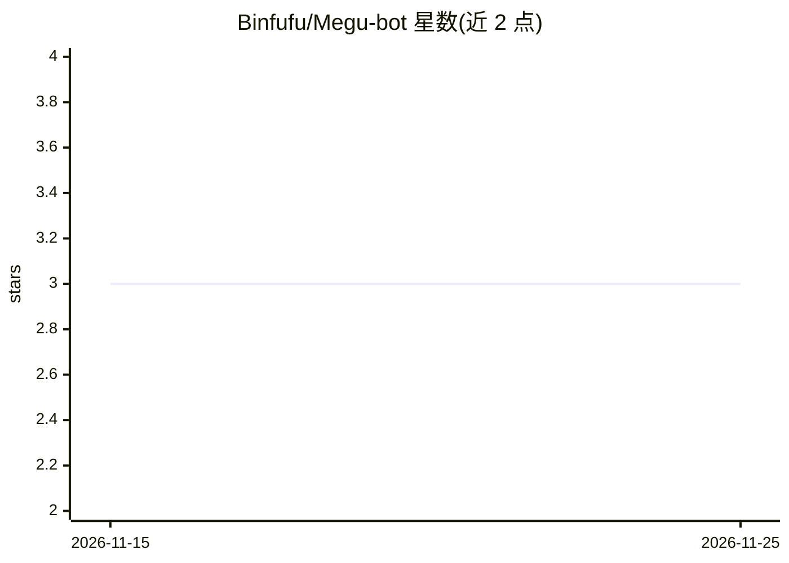

# Binfufu/Megu-bot

⭐ 3 · JavaScript · MIT · 推送 2026-11-23 · [GitHub](https://github.com/Binfufu/Megu-bot) · 个人维护 · 中文 README

**接入 QQ 的长期陪伴角色聊天机器人框架**

Node.js 编写的开源 QQ 机器人框架（公开 v1 子集），面向长期陪伴与角色扮演互动：角色卡以 AGENTS.md 文本作为提示词，配长期记忆层（SQLite 状态库），单轮回复约 5k token、约 90% 输入命中缓存。核心与平台解耦，当前官方支持腾讯 QQ 开放平台（出站 WebSocket + OpenAPI，无需公网入站端口）。公开版默认关闭 tools、定时消息、网页面板等能力，仅提供单实例 demo；无第三方 npm 依赖。

## 筛选速览

| 维度 | 判定 | 备注 |
|---|---|---|
| AI 角色 | `ai-native` | 本体是模型或模型工具 |
| 许可风险 | `permissive` | MIT |
| 部署形态 | `library` | 以包/库形式分发 |
| 模型依赖 | — | README 未给出锁定关系 |
| 硬件要求 | — | 无带数字的原话,不猜 |
| 安装摩擦 | `low` | 无编译、无系统依赖或容器化 |
| 成熟度 | — | 结构信号不足 |

## 能力要点

- 长期记忆系统：记忆不随互动时长减弱，约 90% 输入命中缓存
- 核心与平台解耦，QQ 专用实现约占运行源码 2.3%
- 零第三方 npm 依赖，Node.js 22+ 内置能力运行
- 三个代码层组件：搬图、搬本（JM 边车）、盯梢（订阅源监测），均默认关闭

## 适用场景

- 在 QQ 私聊或群聊中与自定义角色卡长期互动
- 自托管部署个人陪伴机器人并控制模型调用费用
- 接入自己的 OpenAI 兼容模型端点做角色对话
- 通过订阅源监测组件向 QQ 私聊播报更新

## 场景标签

`聊天机器人` `Agent 记忆` · 领域:Agent 开发

## 证据(README 行号)

> L5: - Megu-bot 是面向长期陪伴/轻松互动的机器人项目，设计灵感源于酒馆rp不能长期轻量化游玩/生态孤独，故自制bot框架，将角色放入自定义世界观中，为每个角色搭配长期记忆层系统与多功能组件，再套喜欢的同人角色卡（始于惠惠😋），
> L21: - 在 QQ 私聊或群聊中互动，（直接请求你配置的 OpenAI 兼容模型端点）将回复发至 QQ。

## 星数曲线

2026-11-15 3 → 2026-11-25 3（+0）

---
*卡片 v1 · prompt 1.4 · 生成 2026-11-22 · 置信度 mid · 依据 README sha `5b3fb56b1177` · [字段定义](../../DATASET.md)*
