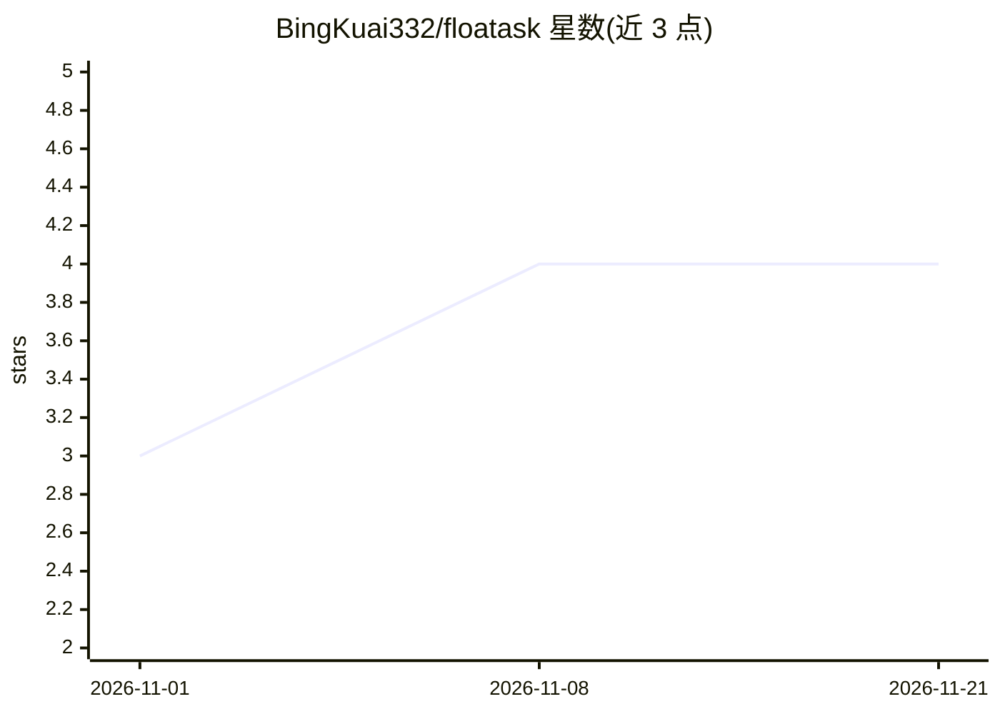

# BingKuai332/floatask

⭐ 4 · JavaScript · MIT · 推送 2026-11-12 · [GitHub](https://github.com/BingKuai332/floatask) · 个人维护 · 中文 README

**Windows 框选屏幕内容的 AI 解释与追问浮窗助手**

基于 Electron 的 Windows 桌面应用：按 Alt+Q 框选任意窗口区域后，先在本机用 Windows 自带 OCR 识别文字，连同前台窗口标题/进程名与可选联网检索结果组成 Prompt 交给模型，在置顶浮窗中输出结构化解释并支持多轮追问。另含截图翻译（Alt+T）、连续多图、历史与收藏、任务级模型覆盖、三套自研主题与便携版自动更新。仅支持 Windows 10/11 x64；OCR 与窗口捕获依赖 Windows API，不支持 macOS/Linux。

## 筛选速览

| 维度 | 判定 | 备注 |
|---|---|---|
| AI 角色 | `ai-native` | 本体是模型或模型工具 |
| 许可风险 | `permissive` | MIT |
| 部署形态 | `desktop` | 安装包/桌面程序 |
| 模型依赖 | local-ok | 支持本地模型 |
| 硬件要求 | — | 无带数字的原话,不猜 |
| 安装摩擦 | `low` | 无编译、无系统依赖或容器化 |
| 成熟度 | — | 结构信号不足 |

## 能力要点

- 本地 OCR + 窗口上下文打包，框选后原地解释与多轮追问
- 联网检索：内置免 Key 必应搜索、自建 SearXNG，回答带来源标注
- 支持 DeepSeek/OpenAI/OpenRouter/Gemini/本地 Ollama 及任何 OpenAI 兼容接口
- 内置 mock 模型服务可无 Key 跑通完整链路

## 适用场景

- 看不懂网页术语时框选后原地获得解释
- 框选 IDE 报错堆栈并结合窗口上下文追问
- 框选图表或界面，交给视觉模型理解
- 截图翻译并联网核查来源

## 场景标签

`AI 助手` · 领域:对话与助手

## 证据(README 行号)

> L4:  悬浮在任意软件、网页上的 AI 屏幕理解助手
> L12: > 框选屏幕上任何看不懂的内容，浮问会结合窗口、上下文和联网资料，用几句话说清它是什么、有什么用、和当前场景有什么关系。然后可以在浮窗里继续追问、举例、深入，或联网核查并给出来源。
> L81: 2. **OCR 在本地完成**：默认只有识别出的文字会离开本机；截图只在开启“截图理解”时发送。

## 星数曲线

2026-11-01 3 → 2026-11-21 4（+1）

---
*卡片 v1 · prompt 1.4 · 生成 2026-11-21 · 置信度 high · 依据 README sha `d6bea7a389c3` · [字段定义](../../DATASET.md)*
