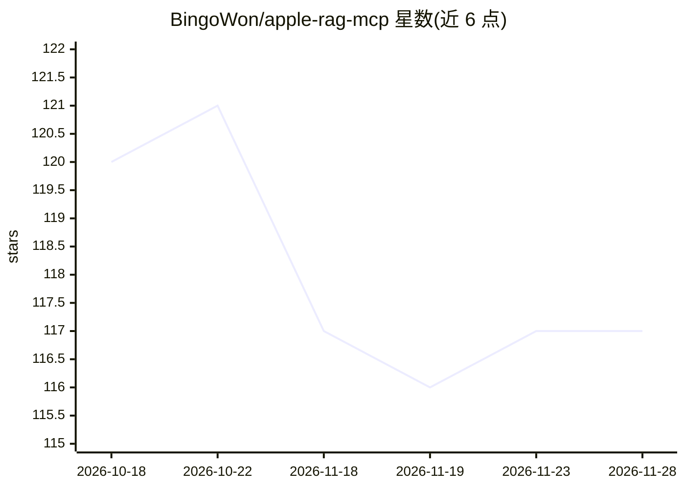

# BingoWon/apple-rag-mcp

⭐ 117 · TypeScript · MIT · 推送 2026-11-26 · [GitHub](https://github.com/BingoWon/apple-rag-mcp) · [官网](https://apple-rag.com) · 组织维护 · 中文 README

**向 AI agent 提供 Apple 开发者文档与 WWDC 检索的 MCP/CLI 服务**

将 37.6 万+ Apple 文档页与 1,880+ WWDC 视频转录索引为可供 agent 调用的知识服务，通过 MCP（Streamable HTTP）或 npm CLI 暴露 search/browse/fetch 三个工具：混合关键词+语义检索（pgvector，Jev 排序）、按主题树浏览 SwiftUI/UIKit、读取源页面并返回出处元数据。托管在 apple-rag.com，匿名可用（30 次/周），源代码以 MIT 开放，本地开发用 pnpm 构建 Cloudflare Worker。

## 筛选速览

| 维度 | 判定 | 备注 |
|---|---|---|
| AI 角色 | `ai-ecosystem` | LLM/agent 周边工具 |
| 许可风险 | `permissive` | MIT |
| 部署形态 | `library` | 以包/库形式分发 |
| 模型依赖 | — | README 未给出锁定关系 |
| 硬件要求 | — | 无带数字的原话,不猜 |
| 安装摩擦 | `low` | 无编译、无系统依赖或容器化 |
| 成熟度 | — | 结构信号不足 |

## 能力要点

- MCP 与 CLI 暴露同一组三工具：search/browse/fetch
- 混合检索：词法+2560 维 pgvector 语义召回，Jev 决策模型排序
- Docs Pulse 每 5 分钟采集框架更新并生成双语趋势摘要与 RSS/JSON
- 4 级 fetch 回退链：索引语料→缓存→官方 DocC JSON→在线提取

## 适用场景

- 让 Claude Code/Cursor 等 agent 在编写 iOS 代码时检索官方文档
- 查询某个 API 在特定 iOS 版本的约束与弃用情况
- 跟踪 Apple 框架发布说明与 beta 变更

## 场景标签

`语义搜索` · 领域:知识与检索

## 证据(README 行号)

> L7: **Apple developer documentation and WWDC transcripts for AI agents — via MCP or CLI.**
> L36: Connect any MCP-capable agent directly to `https://mcp.apple-rag.com` (Streamable HTTP), or copy a tailored setup p
> L77: For agents with shell access (Node.js 22.20+), `apple-rag-cli` exposes the exact same three tools plus a bundled `a

## 星数曲线

2026-10-18 120 → 2026-11-28 117（-3）

---
*卡片 v1 · prompt 1.4 · 生成 2026-11-28 · 置信度 high · 依据 README sha `c711315f71e7` · [字段定义](../../DATASET.md)*
