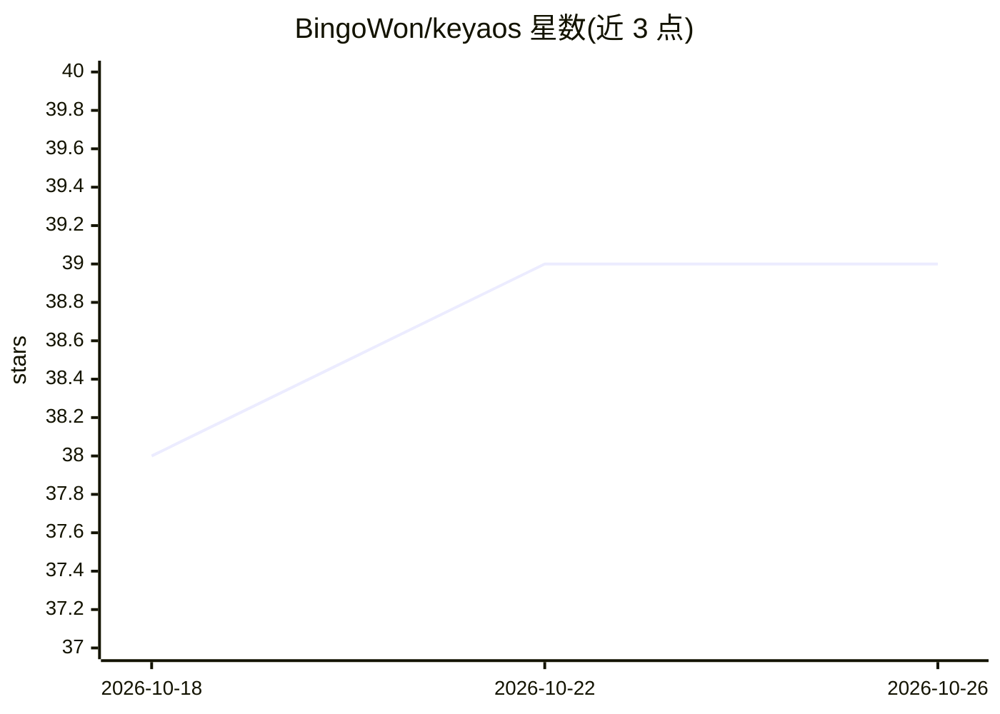

# BingoWon/keyaos

⭐ 39 · TypeScript · MIT · 推送 2026-09-02 · [GitHub](https://github.com/BingoWon/keyaos) · [官网](https://keyaos.com) · 个人维护 · 中文 README

**运行在 Cloudflare Workers 上的多协议 AI API 网关，按成本路由**

面向订阅多家 AI 服务的开发者的边缘 API 网关：将 OpenRouter、DeepSeek、OpenAI、Anthropic 等 14 家提供商统一到 OpenAI/Anthropic/Gemini 等多协议端点后，路由器按 unit_price×multiplier 排序选择最便宜且健康的凭证，配自动故障转移与熔断。基于 Cloudflare Workers+D1+Cron 构建，自托管无需服务器且可运行在免费额度内。提供 React 19 前端（模型目录、价格 K 线图、聊天界面），支持单用户 Core 与多用户 Platform（Clerk+Stripe）两种模式。

## 筛选速览

| 维度 | 判定 | 备注 |
|---|---|---|
| AI 角色 | `ai-ecosystem` | LLM/agent 周边工具 |
| 许可风险 | `permissive` | MIT |
| 部署形态 | `library` | 以包/库形式分发 |
| 模型依赖 | locked-api |  |
| 硬件要求 | — | 无带数字的原话,不猜 |
| 安装摩擦 | `low` | 无编译、无系统依赖或容器化 |
| 成熟度 | — | 结构信号不足 |

## 能力要点

- 按单价排序的成本最优路由与自动故障转移、熔断机制
- 14 家提供商、OpenAI/Anthropic/Gemini/AWS Event Stream 多协议
- SSE 流式响应 tee 转发并在后台提取用量计费
- 一键部署到 Cloudflare Workers，自托管可运行在免费额度内

## 适用场景

- 统一管理多家 AI 服务 API key 并自动选最便宜可用渠道
- 配合 Cursor、Cline、aider 等工具使用自定义 base URL
- 通过 API key 权限（模型限制/配额/IP 白名单）做团队用量管控

## 场景标签

`模型网关` · 领域:Agent 开发

## 证据(README 行号)

> L23: You subscribe to multiple AI services — OpenRouter, DeepSeek, Google AI Studio, xAI, and more. Each has its own API
> L36: **Request flow:** Client sends a request to any supported endpoint. Auth validates the API key and checks permissio
> L44: - **Multi-protocol** — OpenAI Chat & Embeddings, Anthropic Messages, Google Gemini, AWS Event Stream

## 星数曲线

2026-10-18 38 → 2026-10-26 39（+1）

---
*卡片 v1 · prompt 1.4 · 生成 2026-10-25 · 置信度 high · 依据 README sha `9d981652f7e1` · [字段定义](../../DATASET.md)*
