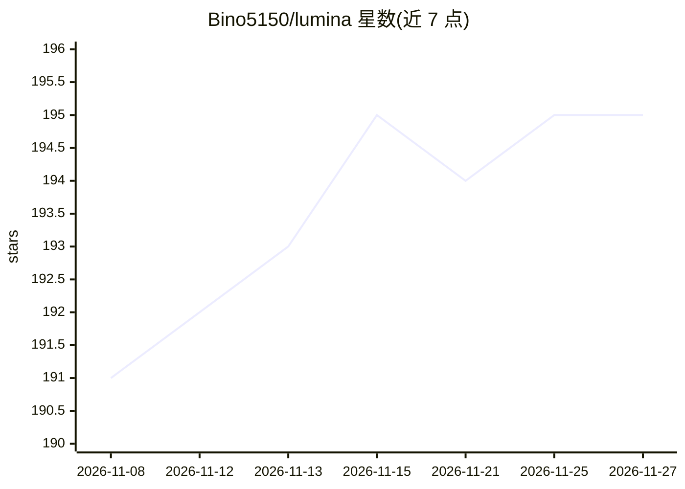

# Bino5150/lumina

⭐ 195 · Python · Apache-2.0 · 推送 2026-11-25 · [GitHub](https://github.com/Bino5150/lumina) · 个人维护

**本地优先的桌面 AI Agent 应用：多层记忆与约 90 个工具**

面向个人用户的本地优先 Agentic AI 桌面应用（Python/PySide6），定位为完整的 agentic 操作系统：多层持久记忆（MemPalace、Dreaming、上下文压缩）、约 90 个内置工具（开启全部可选功能达 105 个）、沙箱代码执行、Git/worktree 软件工程代理、语音克隆与本地 TTS、视觉与图像生成、浏览器伴侣。LLM 层抽象支持 14 种后端运行时切换（llama.cpp/Ollama/vLLM 本地，Anthropic/OpenAI 等云端）。安全模型采用 owner 标志、默认拒绝、紧急停机。处于公开 beta 阶段，在 4GB VRAM 的 Quadro T1000 上构建测试。

## 筛选速览

| 维度 | 判定 | 备注 |
|---|---|---|
| AI 角色 | `ai-native` | 本体是模型或模型工具 |
| 许可风险 | `permissive` | Apache-2.0 |
| 部署形态 | `library` | 以包/库形式分发 |
| 模型依赖 | local-ok | 支持本地模型 |
| 硬件要求 | `gpu-8g` | |
| 安装摩擦 | `medium` | 含编译或系统依赖之一 |
| 成熟度 | `idea` | |

## 能力要点

- 多层持久记忆体系（MemPalace、Dreaming、上下文压缩/Reforge）
- 约 90 个内置工具（含可选功能达 105 个）与命名工具 profile
- 14 种 LLM 后端运行时切换，本地优先（llama.cpp/Ollama/vLLM 等）
- Telegram/Discord 远程访问与浏览器伴侣（读写限定站点）

## 适用场景

- 在个人电脑上运行带持久记忆的本地 AI 助手
- 让代理执行编码任务（Git、测试、diff 审查）
- 通过 Telegram/Discord 远程访问自己的 agent

## 场景标签

`AI 助手` `编码 Agent` `Agent 记忆` · 领域:Agent 开发

## 证据(README 行号)

> L3: A full featured, powerful, and efficient local-first AI Agentic
> L20: - 🔧 Agentic tool framework — ~90 built-in tools out of the box, up to 105 with every optional feature (Subagents, B
> L26: - 🔄 Runtime backend switching across 14 LLM backends

## 星数曲线

2026-11-08 191 → 2026-11-27 195（+4）

---
*卡片 v1 · prompt 1.4 · 生成 2026-11-17 · 置信度 high · 依据 README sha `295cd99f976d` · [字段定义](../../DATASET.md)*
