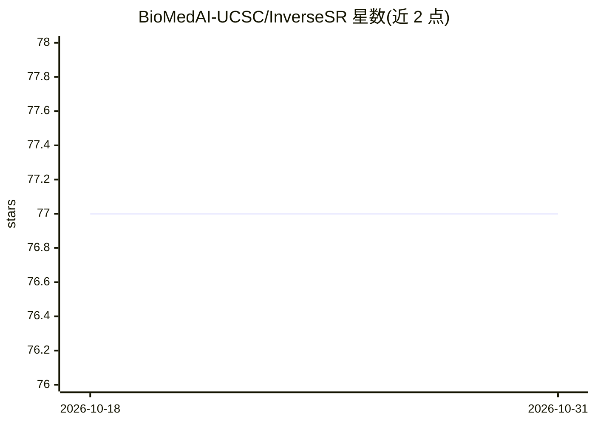

# BioMedAI-UCSC/InverseSR

⭐ 77 · Python · Apache-2.0 · 推送 2026-08-25 · [GitHub](https://github.com/BioMedAI-UCSC/InverseSR) · [官网](http://arxiv.org/abs/2308.12465) · 组织维护

**3D 脑部 MRI 超分辨率重建，基于隐空间扩散模型的无监督方法（MICCAI 2023）**

MICCAI 2023 Early Accept 论文 InverseSR 的 PyTorch 官方实现：利用预训练 Brain LDM 构建 T1w 脑部 MRI 的图像先验，通过在隐空间中搜索最优隐表示 z* 生成超分辨率 MRI；无需配对训练数据，可在测试时适配不同 MRI SR 设定。安装方式为 pip 安装 requirements.txt，需下载 Brain LDM 的 ddpm 与 decoder 参数，运行脚本位于 job_script 目录。README 声明需在至少 80GB 内存的 GPU/CPU 上运行，面向医学影像研究者。

## 筛选速览

| 维度 | 判定 | 备注 |
|---|---|---|
| AI 角色 | `ai-native` | 本体是模型或模型工具 |
| 许可风险 | `permissive` | Apache-2.0 |
| 部署形态 | `library` | 以包/库形式分发 |
| 模型依赖 | — | README 未给出锁定关系 |
| 硬件要求 | — | 无带数字的原话,不猜 |
| 安装摩擦 | `low` | 无编译、无系统依赖或容器化 |
| 成熟度 | `idea` | |

## 能力要点

- 无监督 MRI 超分辨率，无需配对训练数据
- 利用预训练 Brain LDM 在隐空间搜索最优表示 z*
- 测试时可适配不同 MRI SR 设定
- 提供示例数据、低分辨率生成代码与运行脚本

## 适用场景

- 3D T1w 脑部 MRI 的超分辨率重建研究
- 复现 MICCAI 2023 InverseSR 论文方法
- 无配对数据场景下的医学影像逆问题求解

## 场景标签

`图像视频处理` `科研工具` · 领域:学习与行业

## 证据(README 行号)

> L5: We have developed an unsupervised technique for MRI super-resolution. We leverage a recent pre-trained Brain LDM for
> L11: pip install -r requirements.txt

## 星数曲线

2026-10-18 77 → 2026-10-31 77（+0）

---
*卡片 v1 · prompt 1.4 · 生成 2026-10-24 · 置信度 mid · 依据 README sha `2b811c208df5` · [字段定义](../../DATASET.md)*
