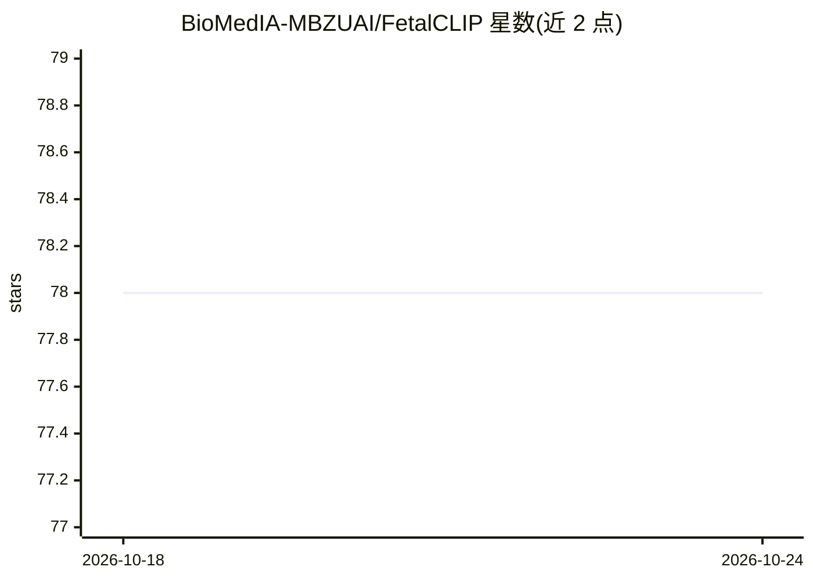

# BioMedIA-MBZUAI/FetalCLIP

⭐ 78 · Python · NOASSERTION · 推送 2026-02-05 · [GitHub](https://github.com/BioMedIA-MBZUAI/FetalCLIP) · [官网](https://biomedia-mbzuai.github.io/FetalCLIP/) · 组织维护

**面向胎儿超声图像分析的视觉-语言基础模型**

由 MBZUAI 与 Corniche Hospital 发表的视觉-语言基础模型，在 210,035 张图文配对的胎儿超声图像上预训练，生成胎儿超声图像的通用表征，可用于分类、孕龄估计、先天性心脏缺陷检测与胎儿结构分割等下游任务，并支持零样本平面分类。基于 open_clip 加载预训练权重，提供 conda/pip 环境配置、权重下载与多个复现脚本目录（零样本评测、线性探测、少样本学习、CAM 可视化、嵌入提取）。

## 筛选速览

| 维度 | 判定 | 备注 |
|---|---|---|
| AI 角色 | `ai-native` | 本体是模型或模型工具 |
| 许可风险 | `none` | NOASSERTION |
| 部署形态 | `library` | 以包/库形式分发 |
| 模型依赖 | — | README 未给出锁定关系 |
| 硬件要求 | — | 无带数字的原话,不猜 |
| 安装摩擦 | `low` | 无编译、无系统依赖或容器化 |
| 成熟度 | — | 结构信号不足 |

## 能力要点

- 在 210,035 张图文配对胎儿超声图像上预训练
- 零样本胎儿平面分类与孕龄估计
- 支持分类、CHD 检测、分割等线性探测下游任务
- 提供零样本/探测/少样本/CAM/嵌入提取复现脚本

## 适用场景

- 用预训练表征做胎儿超声平面分类或孕龄估计
- 在标注数据有限时以少样本线性探测适配下游任务
- 提取胎儿超声图像嵌入用于自建分析流程

## 场景标签

`多模态` · 领域:感知与多模态

## 证据(README 行号)

> L12: FetalCLIP is a vision-language foundation model designed specifically for fetal ultrasound image analysis. Unlike g
> L15: > **Abstract:** *Foundation models are becoming increasingly effective in the medical domain, offering pre-trained 
> L21: - **Zero-Shot Performance:** FetalCLIP achieves outstanding zero-shot performance in fetal plane classification and

## 星数曲线

2026-10-18 78 → 2026-10-24 78（+0）

---
*卡片 v1 · prompt 1.4 · 生成 2026-10-24 · 置信度 mid · 依据 README sha `e95443b1e079` · [字段定义](../../DATASET.md)*
