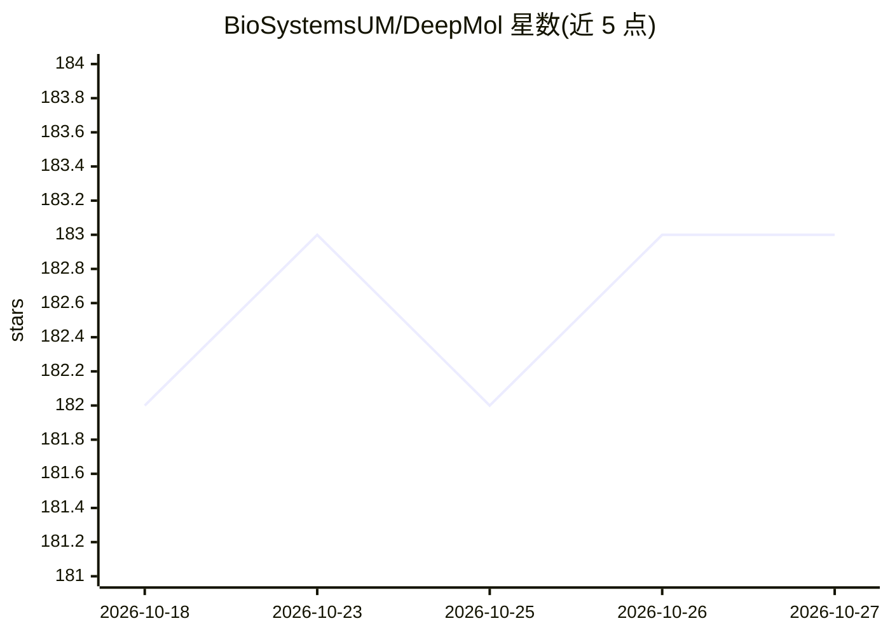

# BioSystemsUM/DeepMol

⭐ 183 · Python · BSD-2-Clause · 推送 2026-03-26 · [GitHub](https://github.com/BioSystemsUM/DeepMol) · 组织维护

**面向药物发现的机器学习/深度学习化学信息学 Python 框架**

葡萄牙米尼奥大学 BioSystems 团队维护的药物发现 ML/DL 框架：以 SMILES 分子数据为输入，覆盖 CSV/SDF 数据加载、化合物标准化（含 ChEMBL Standardizer）、分子指纹与 Mol2Vec 嵌入特征化、特征选择、数据切分、非平衡数据处理、无监督探索（PCA/tSNE/UMAP/KMeans）、模型构建与超参优化、SHAP 特征重要性及 Pipeline 串联。封装 Scikit-learn、Keras、DeepChem 模型于统一接口，基于 RDKit 操作分子数据，提供部署模型 API 的 pip 安装。限制：macOS 加载 TensorFlow 模型存在已知问题；GPU 需自行安装匹配 CUDA 的 TensorFlow/DGL 版本。

## 筛选速览

| 维度 | 判定 | 备注 |
|---|---|---|
| AI 角色 | `ai-native` | 本体是模型或模型工具 |
| 许可风险 | `permissive` | BSD-2-Clause |
| 部署形态 | `self-host` | docker 或自建部署 |
| 模型依赖 | — | README 未给出锁定关系 |
| 硬件要求 | — | 无带数字的原话,不猜 |
| 安装摩擦 | `low` | 无编译、无系统依赖或容器化 |
| 成熟度 | — | 结构信号不足 |

## 能力要点

- 覆盖加载→标准化→特征化→建模→评估→解释的完整分子 ML 工作流
- 统一封装 Scikit-learn / Keras / DeepChem 模型接口
- SHAP 特征重要性并将指纹贡献位绘制到分子结构上
- 提供 Pipeline 与超参优化模块，支持 grid/随机搜索

## 适用场景

- 我在药物发现项目中训练分子分类或回归模型
- 我对分子数据集做特征化、特征选择和非平衡采样
- 我需要解释哪些分子子结构影响了模型预测

## 场景标签

 · 领域:计算化学/药物发现

## 证据(README 行号)

> L23: DeepMol is a Python-based machine and deep learning framework for drug discovery.
> L26: Scikit-learn and DeepChem to build custom ML and DL models or

## 星数曲线

2026-10-18 182 → 2026-10-27 183（+1）

---
*卡片 v1 · prompt 1.4 · 生成 2026-10-22 · 置信度 high · 依据 README sha `90cf41505b8e` · [字段定义](../../DATASET.md)*
