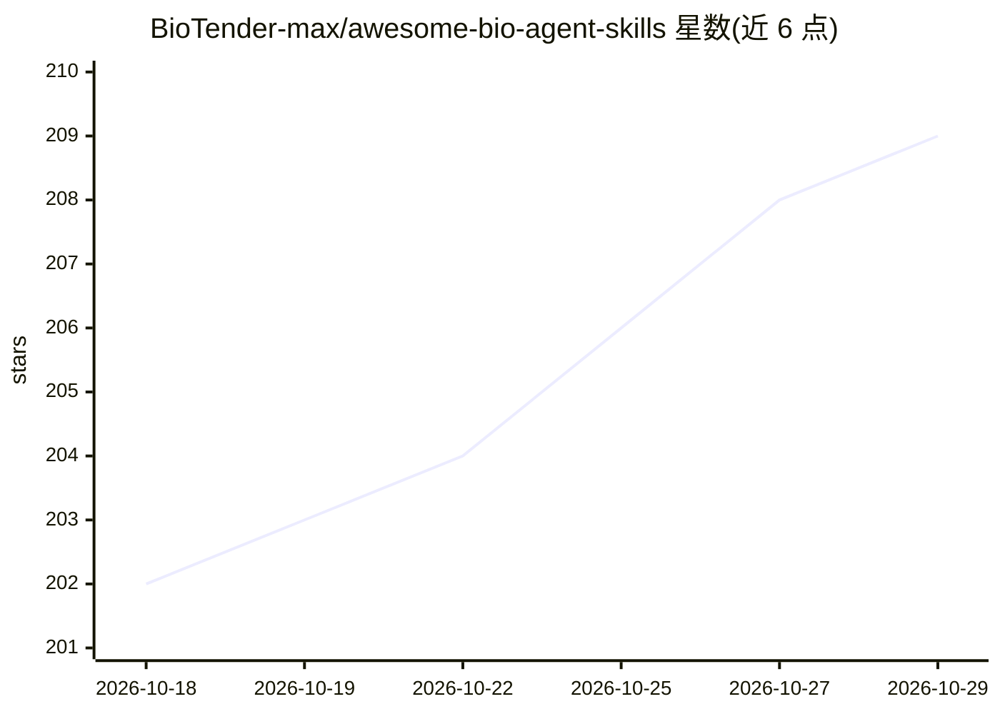

# BioTender-max/awesome-bio-agent-skills

⭐ 209 · Python · NOASSERTION · 推送 2026-07-01 · [GitHub](https://github.com/BioTender-max/awesome-bio-agent-skills) · [官网](https://biotender-max.github.io/awesome-bio-agent-skills/) · 组织维护 · 中文 README

**生物医学 AI agent 技能策展清单（1,722 条，16 类）**

由 BioTender 维护的生物医学研究 agent 技能聚合清单：从 22 个开源仓库去重收录 1,722 个 SKILL.md 格式技能，按基因组学（526 条）、蛋白质组学（167 条）等 16 类组织。技能兼容 Claude 类 agent 框架（OpenClaw、NanoClaw、Biomni），并跟踪 NVIDIA BioNeMo Agent Toolkit 与 Claude Science 内置技能生态。提供 npx bioskill 一次性安装与 npm 全局安装两种按需安装方式。BioTender 为面向 AI for Biology 的智能与媒体平台。

## 筛选速览

| 维度 | 判定 | 备注 |
|---|---|---|
| AI 角色 | `ai-knowledge` | 知识聚合/清单类 |
| 许可风险 | `none` | NOASSERTION |
| 部署形态 | `library` | 以包/库形式分发 |
| 模型依赖 | — | README 未给出锁定关系 |
| 硬件要求 | — | 无带数字的原话,不猜 |
| 安装摩擦 | `low` | 无编译、无系统依赖或容器化 |
| 成熟度 | — | 结构信号不足 |

## 能力要点

- 1,722 个去重技能来自 22 个开源仓库，组织为 16 类
- 技能为自包含 SKILL.md 文件夹，兼容 Claude 类 agent 框架
- 跟踪 NVIDIA BioNeMo Agent Toolkit 与 Claude Science 内置技能
- npx bioskill 免安装一次性使用，或 npm 全局安装

## 适用场景

- 为 Claude 类 agent 框架查找生物医学领域技能
- 了解基因组学、蛋白质组学等方向的 agent 技能覆盖
- 按需安装特定生物信息分析技能到 agent 环境

## 场景标签

`精选清单` `科研工具` · 领域:学习与行业

## 证据(README 行号)

> L28: > A curated collection of AI agent skills for biomedical research, covering genomics, proteomics, single-cell analy
> L32: 1,722 deduplicated skills from 22 open-source repositories, organized into 16 categories. Each skill is a self-cont

## 星数曲线

2026-10-18 202 → 2026-10-29 209（+7）

---
*卡片 v1 · prompt 1.4 · 生成 2026-10-22 · 置信度 high · 依据 README sha `8e463b080d46` · [字段定义](../../DATASET.md)*
