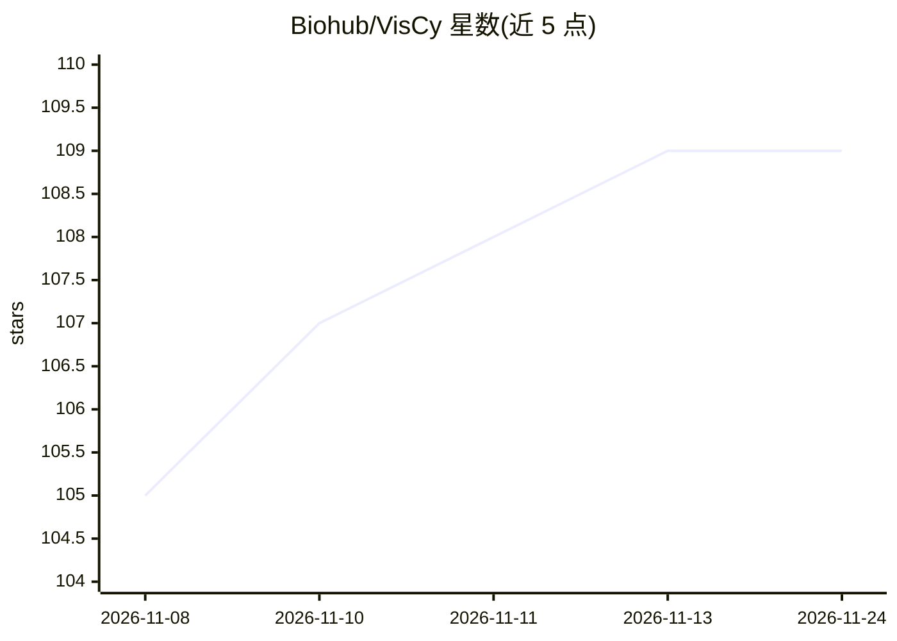

# Biohub/VisCy

⭐ 109 · Jupyter Notebook · BSD-3-Clause · 推送 2026-11-20 · [GitHub](https://github.com/Biohub/VisCy) · [官网](https://biohub.github.io/VisCy/) · 组织维护

**显微镜图像单细胞表型的计算机视觉模型训练部署管线**

VisCy 是用于单细胞分辨率图像表型的深度学习训练与部署管线，提供数据加载、神经网络架构（UNet、对比学习、VAE）、GPU 加速图像变换等分包，以 uv workspace monorepo 组织，各包可通过 pip 单独安装，也可从源码安装。含 Cytoland（从无标记图像生成细胞器虚拟染色）与 DynaCLR（细胞动力学自监督对比学习）两个应用。README 声明为 beta 软件，API 可能在版本间变化。由实验室（mehta-lab）维护，BSD-3-Clause 许可。

## 筛选速览

| 维度 | 判定 | 备注 |
|---|---|---|
| AI 角色 | `ai-native` | 本体是模型或模型工具 |
| 许可风险 | `permissive` | BSD-3-Clause |
| 部署形态 | `library` | 以包/库形式分发 |
| 模型依赖 | — | README 未给出锁定关系 |
| 硬件要求 | — | 无带数字的原话,不猜 |
| 安装摩擦 | `low` | 无编译、无系统依赖或容器化 |
| 成熟度 | `idea` | |

## 能力要点

- 分包提供：数据加载、模型架构（UNet/对比/VAE）、GPU 加速变换、共享基础设施
- Cytoland：从 label-free 图像虚拟染色细胞器
- DynaCLR：细胞动力学的自监督对比学习

## 适用场景

- 显微镜图像的单细胞表型分析
- 从无标记图像生成虚拟染色图像
- 训练细胞动力学自监督表示学习模型

## 场景标签

`图像视频处理` `模型训练` · 领域:感知与多模态

## 证据(README 行号)

> L10: VisCy (blend of `vision` and `cyto`) is a deep learning pipeline for training and deploying computer vision models 
> L21: |viscy-data|Data loading and Lightning DataModules for microscopy|`pip install viscy-data`|

## 星数曲线

2026-11-08 105 → 2026-11-24 109（+4）

---
*卡片 v1 · prompt 1.4 · 生成 2026-11-17 · 置信度 high · 依据 README sha `3affca5a0d30` · [字段定义](../../DATASET.md)*
