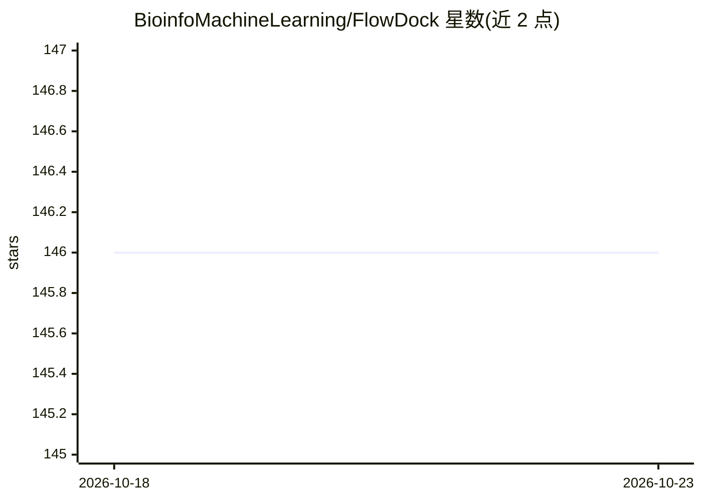

# BioinfoMachineLearning/FlowDock

⭐ 146 · Python · MIT · 推送 2026-09-07 · [GitHub](https://github.com/BioinfoMachineLearning/FlowDock) · 组织维护

**几何流匹配模型：生成蛋白质-配体复合物结构并预测亲和力**

ISMB 2025 论文 FlowDock 的官方 PyTorch/Lightning/Hydra 代码库。模型基于几何流匹配（geometric flow matching），输入蛋白质序列与配体 SMILES（支持多配体，以 | 分隔），生成蛋白质-配体 3D 复合物结构，并可同时输出结合亲和力预测。数据管线提供 ESM2 蛋白质嵌入生成与 ESMFold apo 结构预测脚本，支持 PDBBind、Binding MOAD、DockGen、PLINDER 等数据集的训练、微调与评估。安装方式为 git clone 源码 + Mamba 环境，需下载预训练权重；仓库另含 Docker 说明。面向计算生物学/化学方向的科研用户。

## 筛选速览

| 维度 | 判定 | 备注 |
|---|---|---|
| AI 角色 | `ai-native` | 本体是模型或模型工具 |
| 许可风险 | `permissive` | MIT |
| 部署形态 | `self-host` | docker 或自建部署 |
| 模型依赖 | — | README 未给出锁定关系 |
| 硬件要求 | — | 无带数字的原话,不猜 |
| 安装摩擦 | `low` | 无编译、无系统依赖或容器化 |
| 成熟度 | — | 结构信号不足 |

## 能力要点

- 几何流匹配生成蛋白质-配体复合物结构，附带亲和力预测
- 支持多配体（| 分隔 SMILES）复合物生成与采样轨迹可视化
- 提供 ESM2 嵌入与 ESMFold apo 结构预测的完整数据准备脚本
- 支持 CPU/GPU 训练与命令行参数覆盖（Hydra 配置）

## 适用场景

- 根据蛋白质序列和配体 SMILES 预测复合物 3D 结构
- 在 PDBBind/PLINDER 等数据集上复现论文训练与评估结果
- 微调预训练权重用于新的结合亲和力预测任务

## 场景标签

`科研工具` · 领域:学习与行业

## 证据(README 行号)

> L15: **FlowDock: Geometric Flow Matching for Generative Protein-Ligand Docking and Affinity Prediction**
> L235: python flowdock/sample.py ckpt_path=checkpoints/esmfold_prior_paper_weights-EMA.ckpt model.cfg.prior_type=esmfold 

## 星数曲线

2026-10-18 146 → 2026-10-23 146（+0）

---
*卡片 v1 · prompt 1.4 · 生成 2026-10-22 · 置信度 high · 依据 README sha `f22741a53b81` · [字段定义](../../DATASET.md)*
