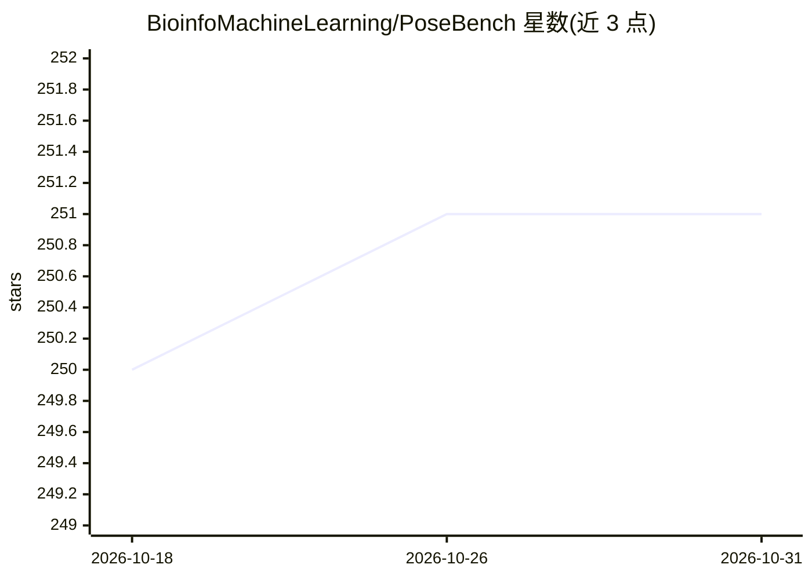

# BioinfoMachineLearning/PoseBench

⭐ 251 · Jupyter Notebook · MIT · 推送 2026-09-01 · [GitHub](https://github.com/BioinfoMachineLearning/PoseBench) · 组织维护

**蛋白质-配体结构预测方法的系统性基准测试框架**

面向计算结构生物学的基准测试框架：对 DiffDock、AutoDock Vina、DynamicBind、AlphaFold 3、Chai-1、Boltz 等固定/柔性蛋白对接与折叠方法在 Astex Diverse、PoseBusters、DockGen、CASP15 数据集上做统一评测，支持单方法与集成推理、结果弛豫与分析。以 pip 包提供便携安装，完整复现需 mamba 环境、git-lfs、约 8.25 GB 模型权重及大量数据下载；版本 1.0.0 存在配体评分 bug，1.1.0 已修正并使各方法性能下调约 15%。

## 筛选速览

| 维度 | 判定 | 备注 |
|---|---|---|
| AI 角色 | `ai-ecosystem` | LLM/agent 周边工具 |
| 许可风险 | `permissive` | MIT |
| 部署形态 | `library` | 以包/库形式分发 |
| 模型依赖 | — | README 未给出锁定关系 |
| 硬件要求 | — | 无带数字的原话,不猜 |
| 安装摩擦 | `medium` | 含编译或系统依赖之一 |
| 成熟度 | — | 结构信号不足 |

## 能力要点

- 覆盖固定蛋白与柔性蛋白两大类共 13 种可单独运行的方法
- 支持方法集成推理与 HPC 作业调度批量实验
- 提供 Jupyter 教程演示如何添加新数据集与新方法
- 预处理的四套基准数据集与各方法预测结果可经 Zenodo 下载复现

## 适用场景

- 为药物发现项目对比选择蛋白-配体对接方法
- 复现 Nature Machine Intelligence 论文中的基准结果
- 将自研对接方法接入统一基准进行评测

## 场景标签

`模型评测` · 领域:评测与运维

## 证据(README 行号)

> L16: Comprehensive benchmarking of protein-ligand structure prediction methods
> L198: |`DiffDock`|Corso et al.|✓|✓|✓|✓|

## 星数曲线

2026-10-18 250 → 2026-10-31 251（+1）

---
*卡片 v1 · prompt 1.4 · 生成 2026-10-22 · 置信度 high · 依据 README sha `cc91a43048fc` · [字段定义](../../DATASET.md)*
