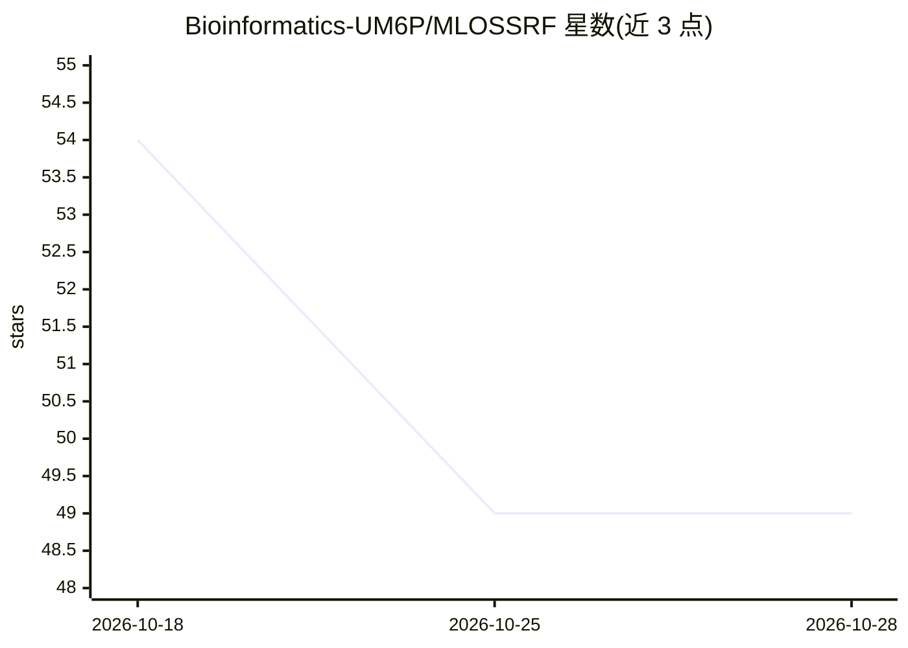

# Bioinformatics-UM6P/MLOSSRF

⭐ 49 · Jupyter Notebook · 推送 2026-03-17 · [GitHub](https://github.com/Bioinformatics-UM6P/MLOSSRF) · [官网](https://doi.org/10.1016/j.atech.2026.101823) · 组织维护

**论文伴生代码：ML 优化摩洛哥麦田氮磷钾施肥推荐**

学术论文《Machine Learning-Based Optimization of Site-Specific NPK Fertilizer Recommendation》的伴生代码库，提供推理与测试的脚本和 Jupyter notebook。基于 7,180 条摩洛哥谷物试验数据（三季、八区），对比 47 个机器学习模型变体的产量预测（随机划分下 sMAPE≈4.5%），并将最优模型嵌入惩罚加权目标函数，用模拟退火、贝叶斯优化、粒子群等 10 种算法生成点位特定 NPK 施肥推荐。完整训练管线与原始数据未包含，仅含处理后样本数据；许可证限非商业研究用途。

## 筛选速览

| 维度 | 判定 | 备注 |
|---|---|---|
| AI 角色 | `ai-native` | 本体是模型或模型工具 |
| 许可风险 | `none` | — |
| 部署形态 | `None` |  |
| 模型依赖 | — | README 未给出锁定关系 |
| 硬件要求 | — | 无带数字的原话,不猜 |
| 安装摩擦 | `low` | 无编译、无系统依赖或容器化 |
| 成熟度 | — | 结构信号不足 |

## 能力要点

- 47 个 ML 模型变体在随机/时序两种划分下的基准测试
- 10 种优化算法（确定性、随机、元启发式、学习型、混合）生成 NPK 推荐
- notebook 覆盖特征工程、训练、特征分析与优化流程
- 提供论文 DOI 与 CC BY 4.0 许可信息

## 适用场景

- 复现论文中的模型评估与施肥优化工作流
- 在自家田块数据上运行点位特定 NPK 推荐推理
- 了解产量预测模型的特征重要性分析做法

## 场景标签

 · 领域:农业/精准农业

## 证据(README 行号)

> L20: This repository provides selected scripts and notebooks related to inference and testing of the proposed machine le
> L24: Efficient fertilizer use is important for sustainable intensification, yet uniform recommendations tend to ignore s
> L28: - Built a scalable machine learning and optimization pipeline on 7,180 Moroccan field trials (three seasons, eight 

## 星数曲线

2026-10-18 54 → 2026-10-28 49（-5）

---
*卡片 v1 · prompt 1.4 · 生成 2026-10-25 · 置信度 high · 依据 README sha `a836c0a7d566` · [字段定义](../../DATASET.md)*
