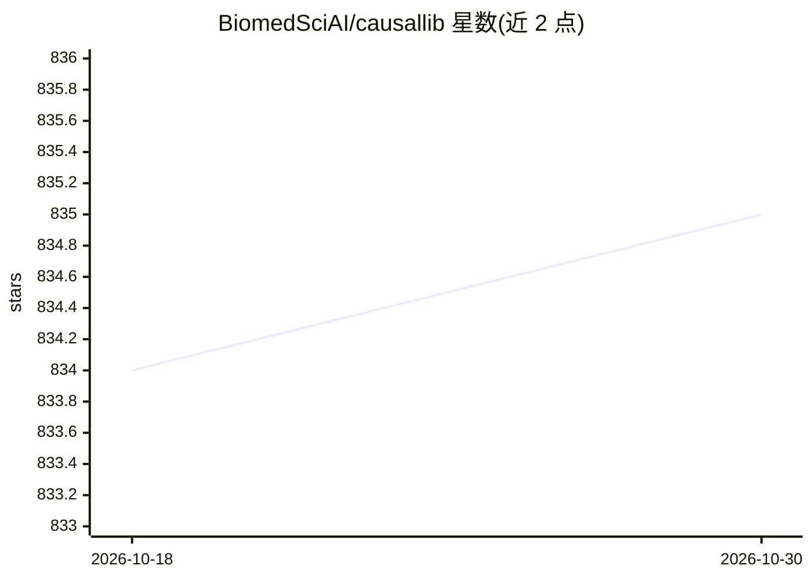

# BiomedSciAI/causallib

⭐ 835 · Python · Apache-2.0 · 推送 2026-05-26 · [GitHub](https://github.com/BiomedSciAI/causallib) · 组织维护

**Python 因果推断分析库：从观察数据估计干预的因果效应**

提供统一 scikit-learn 风格 API 的因果推断方法套件，从观察数据估计干预对结局的因果效应。实现元算法，可插入任意具有 fit-predict 接口的机器学习模型，支持 out-of-bag 效应估计；区分权重模型（IPW/IPTW）与直接结局模型（标准化、可产出 CATE），并附带从因果视角复用 ML 评估的诊断套件。假设输入数据已满足混杂变量选择要求，需领域专家知识配合。由 pip 安装，含 Jupyter 示例。

## 筛选速览

| 维度 | 判定 | 备注 |
|---|---|---|
| AI 角色 | `ai-native` | 本体是模型或模型工具 |
| 许可风险 | `permissive` | Apache-2.0 |
| 部署形态 | `library` | 以包/库形式分发 |
| 模型依赖 | — | README 未给出锁定关系 |
| 硬件要求 | — | 无带数字的原话,不猜 |
| 安装摩擦 | `low` | 无编译、无系统依赖或容器化 |
| 成熟度 | — | 结构信号不足 |

## 能力要点

- 统一 scikit-learn 风格 API 的因果方法套件
- 可插入任意 sklearn 兼容模型的元算法
- out-of-bag 效应估计与 ATE/ATT 分层
- 因果视角的模型评估与诊断套件

## 适用场景

- 用观察数据估计治疗/干预的因果效应
- 在多治疗方案场景下做反事实结局预测
- 诊断因果模型内部机器学习模型的表现

## 场景标签

 · 领域:数据科学/因果推断

## 证据(README 行号)

> L10: A Python package for inferring causal effects from observational data.
> L16: This package provides a suite of causal methods,
> L25: The package also includes an evaluation suite.

## 星数曲线

2026-10-18 834 → 2026-10-30 835（+1）

---
*卡片 v1 · prompt 1.4 · 生成 2026-10-21 · 置信度 high · 依据 README sha `83b40479bc05` · [字段定义](../../DATASET.md)*
