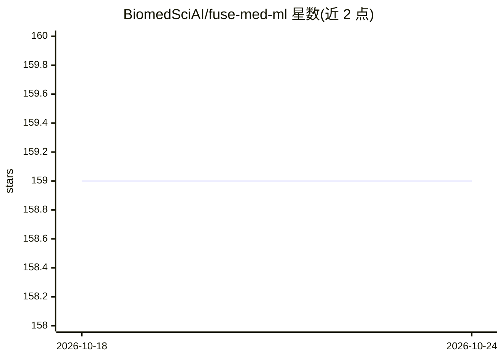

# BiomedSciAI/fuse-med-ml

⭐ 159 · Python · Apache-2.0 · 推送 2026-10-05 · [GitHub](https://github.com/BiomedSciAI/fuse-med-ml) · 组织维护

**面向医学 ML 研究的 Python 框架，通过代码复用加速研发**

FuseMedML 是用于医学领域机器学习研究的 Python 框架，属于 PyTorch Ecosystem。核心机制是以嵌套字典（NDict）承载多模态数据，组件通过声明读写的路径键实现跨项目复用；内置 fuse.data（声明式数据处理流水线与缓存）、fuse.eval（独立模型评测库，含统计显著性检验/校准/阈值化/模型比较）、fuse.dl（可复用模型结构与损失函数）。安装需先建 conda 环境并装 PyTorch，再 pip 安装或从 PyPI 安装，可选装 fuseimg 等域扩展与示例。有 JOSS 论文（2023）。

## 筛选速览

| 维度 | 判定 | 备注 |
|---|---|---|
| AI 角色 | `ai-ecosystem` | LLM/agent 周边工具 |
| 许可风险 | `permissive` | Apache-2.0 |
| 部署形态 | `library` | 以包/库形式分发 |
| 模型依赖 | — | README 未给出锁定关系 |
| 硬件要求 | — | 无带数字的原话,不猜 |
| 安装摩擦 | `medium` | 含编译或系统依赖之一 |
| 成熟度 | — | 结构信号不足 |

## 能力要点

- NDict 嵌套字典 + 路径键的组件设计，支持跨项目复用
- fuse.data 声明式数据处理流水线，含缓存陈旧自动检测
- fuse.eval 独立评测库：统计显著性、校准、阈值化、模型比较
- 支持域扩展机制（fuseimg，fusedrug 计划中）

## 适用场景

- 在医学影像等多模态数据上搭建可复用的 ML 研究流水线
- 跨研究项目移植模型、损失、数据处理算子等组件
- 对（非 FuseMedML 训练的）ML 模型做评测与模型比较

## 场景标签

`模型评测` `MLOps` · 领域:评测与运维

## 证据(README 行号)

> L12: A python framework accelerating ML based discovery in the medical field by encouraging code reuse. Batteries includ
> L99: ### **fuse.data** - A **declarative** super flexible data processing pipeline
> L109: ### **fuse.dl** - reusable dl (deep learning) model architecture components, loss functions, etc.

## 星数曲线

2026-10-18 159 → 2026-10-24 159（+0）

---
*卡片 v1 · prompt 1.4 · 生成 2026-10-22 · 置信度 high · 依据 README sha `09c4286fb698` · [字段定义](../../DATASET.md)*
