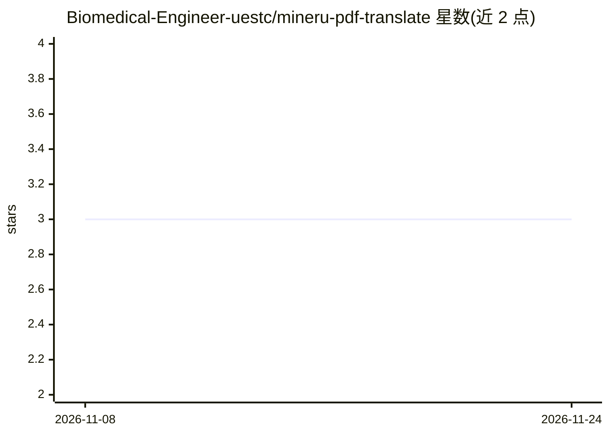

# Biomedical-Engineer-uestc/mineru-pdf-translate

⭐ 3 · Python · MIT · 推送 2026-10-20 · [GitHub](https://github.com/Biomedical-Engineer-uestc/mineru-pdf-translate) · 个人维护 · 中文 README

**给 Agent/科研者：用 MinerU+LLM 把英文论文 PDF 翻译成重排版的中文 PDF**

面向 AI Agent 的翻译技能（也可手动跑脚本）：先由 MinerU 解析 PDF 为 markdown 与独立图片文件，预处理阶段把图片、公式、表格替换为占位符并按章节切块，LLM 只读文字完成分块翻译，脚本再经校验、回填占位符，用 pandoc 转 HTML 并以 Edge/Chrome 无头打印生成中文 PDF。提供 flash/basic/standard/advanced 四档解析、断点续传与逐块结构校验。限制：仅面向有文字层的 PDF，输出为重新排版文档，目标排版为中文向，成稿仍需人工核对。

## 筛选速览

| 维度 | 判定 | 备注 |
|---|---|---|
| AI 角色 | `ai-native` | 本体是模型或模型工具 |
| 许可风险 | `permissive` | MIT |
| 部署形态 | `desktop` | 安装包/桌面程序 |
| 模型依赖 | — | README 未给出锁定关系 |
| 硬件要求 | — | 无带数字的原话,不猜 |
| 安装摩擦 | `low` | 无编译、无系统依赖或容器化 |
| 成熟度 | — | 结构信号不足 |

## 能力要点

- 文字与图片分离：图表/公式压缩为占位符，翻译阶段模型不读图像
- 四档解析（flash/basic/standard/advanced）与断点续传
- 逐块校验占位符、公式、标题、段落与整段漏译
- 排版由 pandoc+浏览器打印生成，不依赖 TeX 发行版

## 适用场景

- 快速读懂英文期刊论文或预印本
- 按 token 计费调用 API 时压低翻译成本
- 让 Agent 直接读文献并产出中文 PDF

## 场景标签

`科研工具` `文档解析` `AI 写作` · 领域:内容生成

## 证据(README 行号)

> L3: **用 MinerU 提取论文，翻译文字、保留图表，生成重新排版的中文 PDF —— 翻译阶段模型只读文字，不读图片。**
> L5: 一个面向 AI Agent 的技能（也可以完全手动跑脚本）：把一篇英文论文变成排版端正的中文 PDF，公式、图片、表格按阅读顺序回填，参考文献不浪费算力。
> L59:  ├─ LLM 分块翻译 ──→ 翻译阶段读取文字和占位符

## 星数曲线

2026-11-08 3 → 2026-11-24 3（+0）

---
*卡片 v1 · prompt 1.4 · 生成 2026-11-22 · 置信度 high · 依据 README sha `07fc7611819b` · [字段定义](../../DATASET.md)*
