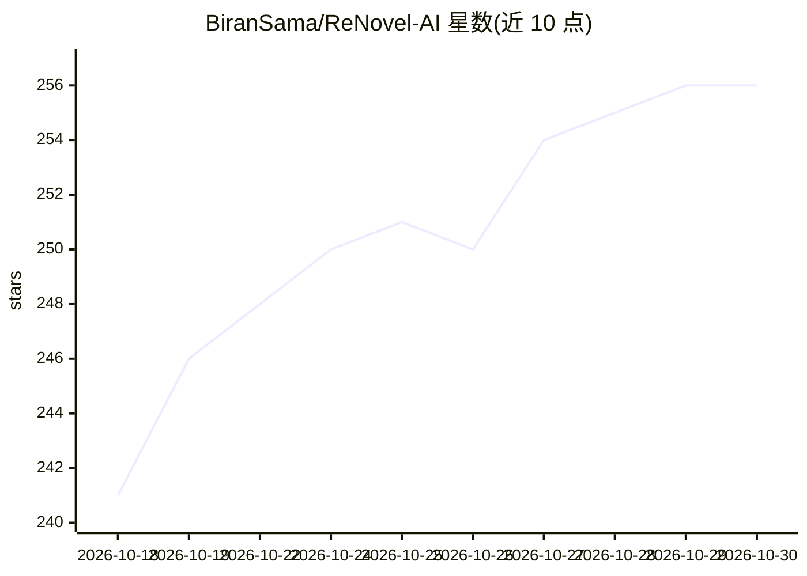

# BiranSama/ReNovel-AI

⭐ 256 · Python · GPL-3.0 · 推送 2026-10-14 · [GitHub](https://github.com/BiranSama/ReNovel-AI) · 个人维护 · 中文 README

**本地化 AI 小说精修工作台，面向小说作者的重写/扩写/校验**

面向小说作者的自托管 Web 应用：导入 TXT 自动分章并全转向量化存入 SQLite，基于 RAG 检索全书伏笔与人物设定，提供 Writer/Reviewer/Chat 三 AI 协作、卡片式段落级对比编辑器、全书批量精修流水线（断点续传、副本回滚）。嵌入向量默认由本地 bge-small-zh（ONNX）生成，模型服务支持 OpenAI/DeepSeek/Gemini/Ollama 等 OpenAI 兼容接口。提供 Windows 绿色版可执行包，其他平台从源码运行。酒馆角色卡导入为待办项。

## 筛选速览

| 维度 | 判定 | 备注 |
|---|---|---|
| AI 角色 | `ai-native` | 本体是模型或模型工具 |
| 许可风险 | `viral` | GPL-3.0 |
| 部署形态 | `desktop` | 安装包/桌面程序 |
| 模型依赖 | local-ok | 支持本地模型 |
| 硬件要求 | — | 无带数字的原话,不猜 |
| 安装摩擦 | `low` | 无编译、无系统依赖或容器化 |
| 成熟度 | — | 结构信号不足 |

## 能力要点

- SQLite+numpy 向量记忆，本地 bge-small-zh 嵌入，无需 PyTorch
- Writer/Reviewer/Chat 三模态 AI 协作与一致性检查
- 全书自动化精修流水线，断点续传与项目副本回滚
- 段落级原文/AI 改写对齐的卡片流式编辑器

## 适用场景

- 导入长篇小说，让 AI 逐章精修或扩写并保持设定一致
- 通过聊天助手查询全书情节与人物出场
- 对比原文与 AI 改写，手动插入/删除段落控制成稿

## 场景标签

`AI 写作` `RAG` `文档问答` · 领域:内容生成

## 证据(README 行号)

> L29: - [x] **根据需求进行精修**
> L46: ### 1. 🧠 全局记忆与一致性 (RAG Memory)
> L61: |**Writer (作家)**|负责根据你的指令进行改写、润色、扩写。|

## 星数曲线

2026-10-18 241 → 2026-10-30 256（+15）

---
*卡片 v1 · prompt 1.4 · 生成 2026-10-22 · 置信度 mid · 依据 README sha `6d4fb2efc5f8` · [字段定义](../../DATASET.md)*
