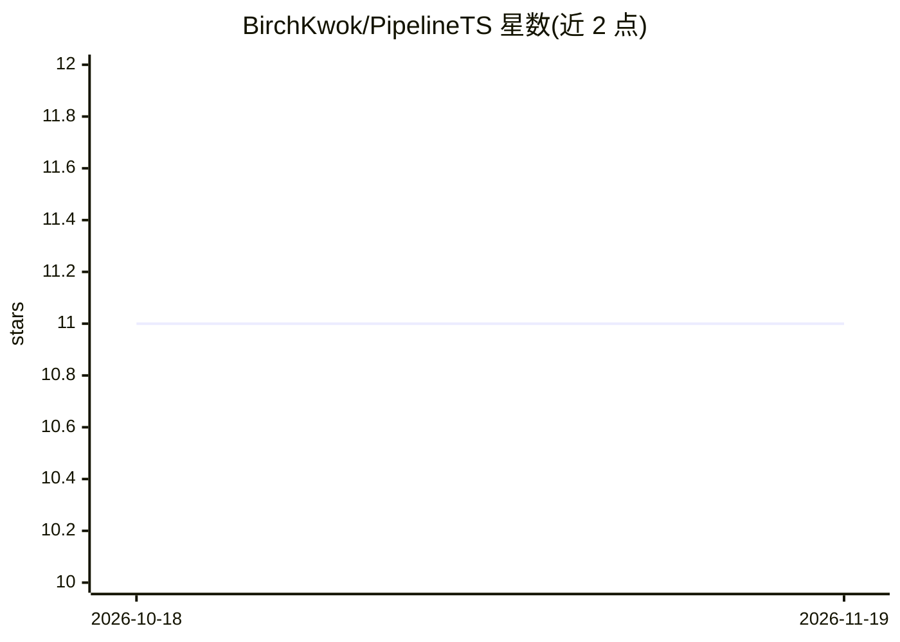

# BirchKwok/PipelineTS

⭐ 11 · Python · Apache-2.0 · 推送 2026-05-20 · [GitHub](https://github.com/BirchKwok/PipelineTS) · 个人维护

**面向开发者/数据科学者的时间序列预测 AutoML 库**

Python 时间序列预测库，提供从预处理到预测的流水线：一行 forecast() 自动推断列、清洗数据并执行 AutoML；SmartRouter 依据数据特征选择模型、滞后阶、缩放器、超参和集成；内置 50+ 模型（34 个神经网络、8 个机器学习、统计基线与可选零样本基础模型），支持 CQR 共形区间、多分位数预测、面板数据、协变量、增量学习与 Optuna 调参。安装要求 Python ≥ 3.9，torch 为可选依赖，文档与 Jupyter 教程随仓库提供。

## 筛选速览

| 维度 | 判定 | 备注 |
|---|---|---|
| AI 角色 | `ai-native` | 本体是模型或模型工具 |
| 许可风险 | `permissive` | Apache-2.0 |
| 部署形态 | `library` | 以包/库形式分发 |
| 模型依赖 | — | README 未给出锁定关系 |
| 硬件要求 | — | 无带数字的原话,不猜 |
| 安装摩擦 | `low` | 无编译、无系统依赖或容器化 |
| 成熟度 | — | 结构信号不足 |

## 能力要点

- forecast() 一行完成自动列推断、清洗与 AutoML
- 50+ 内置模型：34 个 NN、8 个 ML、统计基线与 6 个可选零样本基础模型
- SmartRouter 自动选择模型/滞后/缩放器/超参/集成，内置 Optuna HPO
- CQR 共形区间与多分位数预测，.pts 保存格式含 SHA-256 校验

## 适用场景

- 一行代码对销售等业务数据生成未来多步预测
- 对多序列面板数据批量建模并输出分位数区间
- 用 walk-forward 回测比较多个模型的预测表现

## 场景标签

`数据分析` · 领域:效率与自动化

## 证据(README 行号)

> L8: > **⚡ Simplest and most professional TimeSeries forecasting + AutoML.**
> L26: pred = forecast("sales.csv", n=12)   # auto-infers columns, cleans data, runs AutoML
> L67: |**SmartRouter AutoML**|Profiles data → selects models, lags, scaler, hyperparams, ensemble|

## 星数曲线

2026-10-18 11 → 2026-11-19 11（+0）

---
*卡片 v1 · prompt 1.4 · 生成 2026-11-19 · 置信度 high · 依据 README sha `26bd0e1c2359` · [字段定义](../../DATASET.md)*
