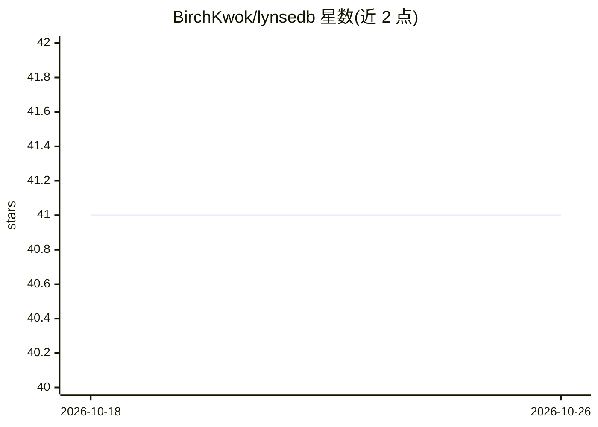

# BirchKwok/lynsedb

⭐ 41 · Rust · Apache-2.0 · 推送 2026-08-25 · [GitHub](https://github.com/BirchKwok/lynsedb) · [官网](https://birchkwok.github.io/lynsedb) · 个人维护

**Python 优先的嵌入式向量数据库，可平滑扩展为服务与轻量集群**

LynseDB 是以 Python 客户端为主接口、Rust 内核承载存储与检索的向量数据库。同一客户端 API 支持三种部署形态：嵌入式（单进程本地目录）、HTTP 服务模式（API key、健康检查、metrics、OpenAPI）和协调器分片集群（哈希分桶路由、副本写镜像、主节点晋升）。检索能力覆盖稠密/稀疏向量、BM25、混合搜索、SQL 式元数据过滤、命名向量字段与外部重排钩子；除嵌入外还支持坐标（Haversine）、二进制指纹、数值分布等多类原生距离度量。README 自述演进较快，建议固定版本并在升级前测试迁移。需 Python 3.9+，通过 pip 安装，提供 Docker 镜像。

## 筛选速览

| 维度 | 判定 | 备注 |
|---|---|---|
| AI 角色 | `ai-ecosystem` | LLM/agent 周边工具 |
| 许可风险 | `permissive` | Apache-2.0 |
| 部署形态 | `self-host` | docker 或自建部署 |
| 模型依赖 | — | README 未给出锁定关系 |
| 硬件要求 | — | 无带数字的原话,不猜 |
| 安装摩擦 | `low` | 无编译、无系统依赖或容器化 |
| 成熟度 | `idea` | |

## 能力要点

- 同一客户端 API 覆盖嵌入式、HTTP 服务、分片集群三种部署形态
- 索引家族包括 Flat、HNSW、IVF、SPANN、DiskANN 与量化变体
- BM25、混合搜索（RRF/加权）、稀疏向量、外部重排钩子
- 嵌入之外的领域距离度量：Haversine、Tanimoto/Hamming、Hellinger、Wasserstein-1D 等

## 适用场景

- RAG / 语义检索 / agent 记忆的本地原型，后续无需改代码升级为服务
- 多进程或多应用共享访问的向量检索服务部署
- 分子指纹、传感器曲线、地理坐标等非嵌入数据的相似度检索

## 场景标签

`向量数据库` · 领域:知识与检索

## 证据(README 行号)

> L5: **LynseDB is a Python-first vector database with a Rust storage and search
> L10: It is a good fit for RAG, semantic search, agent memory, multimodal retrieval,
> L32: - **AI-native retrieval**: dense vectors, metadata filters, BM25, hybrid search,

## 星数曲线

2026-10-18 41 → 2026-10-26 41（+0）

---
*卡片 v1 · prompt 1.4 · 生成 2026-10-25 · 置信度 high · 依据 README sha `f1f72e9b85cc` · [字段定义](../../DATASET.md)*
