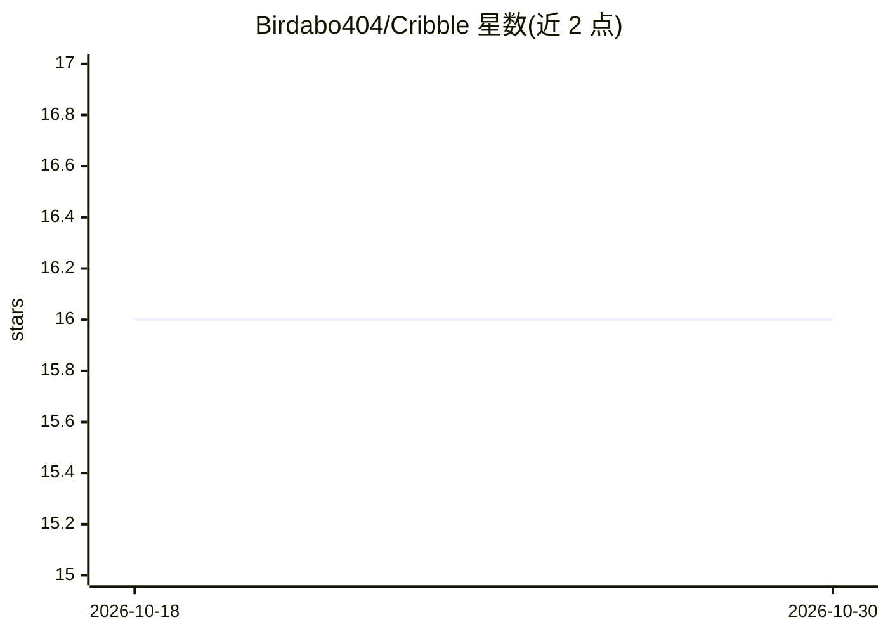

# Birdabo404/Cribble

⭐ 16 · TypeScript · 推送 2026-10-07 · [GitHub](https://github.com/Birdabo404/Cribble) · [官网](https://cribble.dev/leaderboard) · 组织维护

**统计 AI 工具使用时长的浏览器扩展与全球排行榜**

Chrome 扩展，测量用户在 ChatGPT、Claude、Cursor 等数十个 AI 工具上的活跃时长，转换为每日得分、连续打卡、赛季与全球排名。仅记录支持域名上的活跃/空闲时长与访问，不读取提示词、页面内容、键盘输入或截图。仓库公开仅用于代码审查，代码为专有，非自托管或开源发行。当前为私有 Beta，仅限邀请，技术栈为 Next.js/TypeScript/Supabase。

## 筛选速览

| 维度 | 判定 | 备注 |
|---|---|---|
| AI 角色 | `ai-enhanced` | 去掉 AI 部分产品仍成立 |
| 许可风险 | `none` | — |
| 部署形态 | `None` |  |
| 模型依赖 | — | README 未给出锁定关系 |
| 硬件要求 | — | 无带数字的原话,不猜 |
| 安装摩擦 | `low` | 无编译、无系统依赖或容器化 |
| 成熟度 | `idea` | |

## 能力要点

- 跨 ChatGPT、Claude、Cursor 等数十个 AI 工具统计活跃时长
- 活跃时长转化为每日得分、streaks、赛季与全球排名
- 只记录域名与时长，不读取提示词、页面内容、键盘输入或截图
- 仓库公开供审查，代码保持专有（非开源发行）

## 适用场景

- 量化查看自己每天在各 AI 工具上花的时间
- 与朋友比较 AI 使用时长与排名
- 通过公开仓库核查扩展的数据采集范围

## 场景标签

 · 领域:生产力/使用行为追踪

## 证据(README 行号)

> L13: Cribble measures active time across ChatGPT, Claude, Cursor, and dozens more, then turns showing up into scores, st
> L33: This repository is public so anyone can look behind cribble.dev and judge the product by its code, not a trust-us p

## 星数曲线

2026-10-18 16 → 2026-10-30 16（+0）

---
*卡片 v1 · prompt 1.4 · 生成 2026-10-30 · 置信度 high · 依据 README sha `f09a3af1e965` · [字段定义](../../DATASET.md)*
