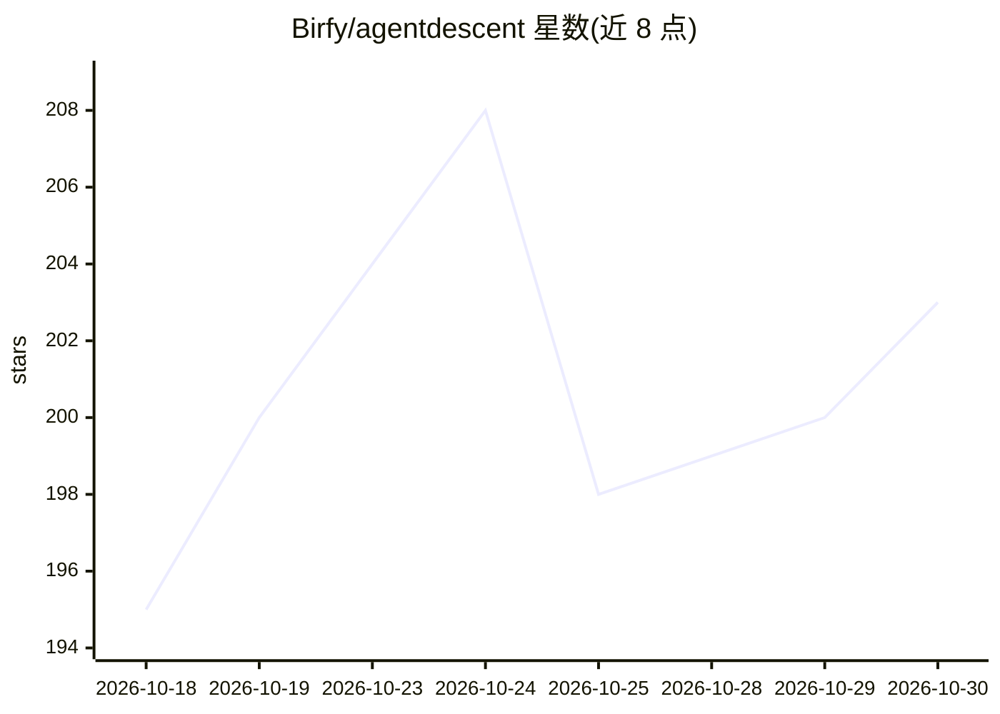

# Birfy/agentdescent

⭐ 203 · Python · MIT · 推送 2026-10-29 · [GitHub](https://github.com/Birfy/agentdescent) · [官网](https://birfy.github.io/agentdescent/) · 个人维护

**自进化 agent 的并行异步优化框架：以 diff 为梯度合并改进**

面向研究者的自进化 agent 参考实现：N 个 worker 并行对共享工件（提示词、技能、harness）提出 diff，单一聚合线程经五阶段冲突解决与融合流程提交到 git 版本化账本，突破串行自改进每次迭代只接受一个变更的上界。提供 evolve() 单入口、可替换的 Strategy 与八个策略槽，内置 23 个已发表自进化算法移植。凭 OPENAI_BASE_URL 切换 provider（DeepSeek/GLM/本地 vLLM/OpenAI），打包离线 demo 无需 API key。附带论文（LaTeX 在 paper 分支），README 自述为研究参考实现而非生产系统。

## 筛选速览

| 维度 | 判定 | 备注 |
|---|---|---|
| AI 角色 | `ai-ecosystem` | LLM/agent 周边工具 |
| 许可风险 | `permissive` | MIT |
| 部署形态 | `library` | 以包/库形式分发 |
| 模型依赖 | local-ok | 支持本地模型 |
| 硬件要求 | — | 无带数字的原话,不猜 |
| 安装摩擦 | `low` | 无编译、无系统依赖或容器化 |
| 成熟度 | — | 结构信号不足 |

## 能力要点

- 并行 worker 提出 diff + 聚合器五阶段合并提交到 git 账本
- 23 个已发表自进化算法（GEPA、ACE、PromptBreeder 等）以插件形式移植
- 打包离线 demo 无需模型 API key，pytest 离线确定性运行
- 可作为 Claude Code / Codex / OpenCode 等 agent 的插件与 MCP server 使用

## 适用场景

- 在数据集上自动进化提示词或技能库
- 复现/对比已发表的自进化算法（作为受控调度变量）
- 在 Claude Code 等 agent 宿主内发起并检查进化任务

## 场景标签

`Agent 框架` `提示工程` · 领域:Agent 开发

## 证据(README 行号)

> L7: > **Gradient descent — but the parameters are agents.** A parallel, asynchronous
> L104: One entry point, `evolve()`, and three building blocks that turn a dataset into
> L215: Published self-evolution algorithms run as plug-ins rather than forks, under

## 星数曲线

2026-10-18 195 → 2026-10-30 203（+8）

---
*卡片 v1 · prompt 1.4 · 生成 2026-10-22 · 置信度 high · 依据 README sha `5f420109e146` · [字段定义](../../DATASET.md)*
