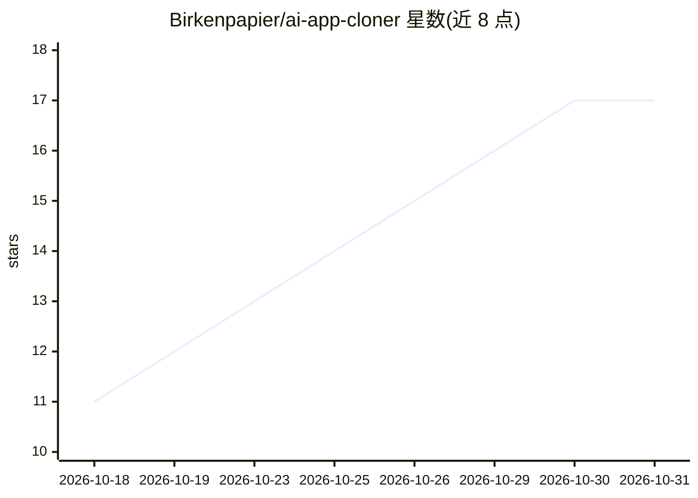

# Birkenpapier/ai-app-cloner

⭐ 17 · JavaScript · MIT · 推送 2026-07-16 · [GitHub](https://github.com/Birkenpapier/ai-app-cloner) · 个人维护

**从手机应用截图重建可运行 Expo/RN 应用的 Claude Code 技能**

面向 AI 编码 agent（Claude Code 为参考实现）的开源技能/插件：用户提供应用截图文件夹，agent 推断屏幕、导航与设计系统，生成可运行的 Expo / React Native 项目。核心机制是 diff 循环——渲染生成的界面、截图并与原截图比对、迭代修正直至匹配；中途产出中间表示 app-spec.json，可选 backend 模式再生成 Drizzle/tRPC 类型化本地数据层。需 Node 18+、一个 skill 兼容的编码 agent 及浏览器自动化 MCP 方可运行主流程；README 明确截图模式覆盖度取决于截取范围，backend 推断约还原 60-80% 的 schema。

## 筛选速览

| 维度 | 判定 | 备注 |
|---|---|---|
| AI 角色 | `ai-ecosystem` | LLM/agent 周边工具 |
| 许可风险 | `permissive` | MIT |
| 部署形态 | `library` | 以包/库形式分发 |
| 模型依赖 | — | README 未给出锁定关系 |
| 硬件要求 | — | 无带数字的原话,不猜 |
| 安装摩擦 | `low` | 无编译、无系统依赖或容器化 |
| 成熟度 | `idea` | |

## 能力要点

- 截图→屏幕聚类→导航图→app-spec.json 中间表示→RN 项目生成
- 渲染-截图-比对-修正的 diff 循环逼近视觉一致
- 可选 backend 模式生成 Drizzle schema、tRPC CRUD 与本地持久层
- 技能文件从单一真源生成，适配 Claude Code、Cursor、Codex CLI 等 13 种编码 agent

## 适用场景

- 把已有手机应用的截图变成可运行的 React Native 原型
- 将网页应用转换为 React Native 项目（Web→RN 模式）
- 在 Expo 项目中快速获得带本地数据持久化的应用骨架
- 直接运行 demo/* 分支查看 Discord、Todoist 等六个重建示例

## 场景标签

`代码生成` · 领域:编码与开发

## 证据(README 行号)

> L11: You point your coding agent at a folder of screenshots. It works out the screens,
> L112: The `/clone-app` skill is generated for every major AI coding agent from one source
> L119: |Claude Code|`/clone-app` (reference implementation)|

## 星数曲线

2026-10-18 11 → 2026-10-31 17（+6）

---
*卡片 v1 · prompt 1.4 · 生成 2026-10-30 · 置信度 high · 依据 README sha `2c2b7cce313d` · [字段定义](../../DATASET.md)*
