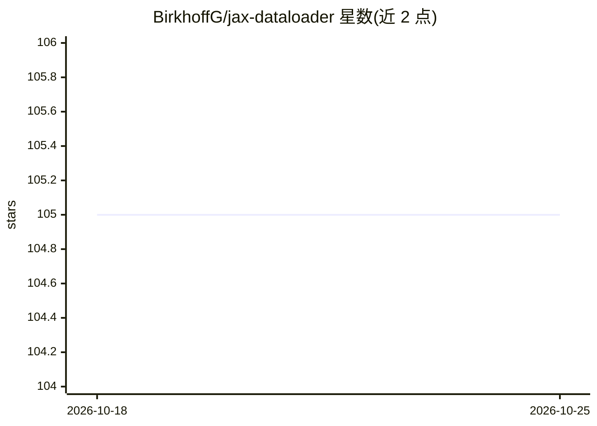

# BirkhoffG/jax-dataloader

⭐ 105 · Jupyter Notebook · Apache-2.0 · 推送 2025-12-16 · [GitHub](https://github.com/BirkhoffG/jax-dataloader) · [官网](https://birkhoffg.github.io/jax-dataloader/) · 个人维护

**为 JAX 提供 PyTorch 风格数据加载器的 Python 库**

Python 库 jax_dataloader，将 PyTorch 风格的 DataLoader API 引入 JAX：支持 4 类数据集（jax、huggingface datasets、PyTorch Dataset、TensorFlow dataset）与 3 种批量加载后端（jax/pytorch/tensorflow），并提供数据集与后端的兼容性对照表。默认安装仅含 jax 与 plum-dispatch 两个依赖，PyTorch/HuggingFace/TensorFlow 集成需手动安装或通过 extras 安装。提供 manual_seed 全局种子设置与 ArrayDataset 封装多个 jax.numpy 数组的工具。

## 筛选速览

| 维度 | 判定 | 备注 |
|---|---|---|
| AI 角色 | `ai-ecosystem` | LLM/agent 周边工具 |
| 许可风险 | `permissive` | Apache-2.0 |
| 部署形态 | `library` | 以包/库形式分发 |
| 模型依赖 | — | README 未给出锁定关系 |
| 硬件要求 | — | 无带数字的原话,不猜 |
| 安装摩擦 | `low` | 无编译、无系统依赖或容器化 |
| 成熟度 | — | 结构信号不足 |

## 能力要点

- 支持 4 类数据集与 3 种加载后端（jax/pytorch/tensorflow）
- 提供数据集-后端兼容性对照表
- 默认依赖仅 jax 与 plum-dispatch
- ArrayDataset 可将多个 jax.numpy 数组封装为可在全部后端加载的数据集

## 适用场景

- 在 JAX 训练流程中以熟悉的 PyTorch DataLoader API 加载数据
- 直接加载 HuggingFace / PyTorch / TensorFlow 数据集进入 JAX
- 复用 torchvision 等已有数据生态配合 JAX 使用

## 场景标签

 · 领域:机器学习工具库

## 证据(README 行号)

> L17: `jax_dataloader` brings *pytorch-like* dataloader API to `jax`. It
> L28: - **3 backends to iteratively load batches**:

## 星数曲线

2026-10-18 105 → 2026-10-25 105（+0）

---
*卡片 v1 · prompt 1.4 · 生成 2026-10-23 · 置信度 high · 依据 README sha `a320f53eebc7` · [字段定义](../../DATASET.md)*
