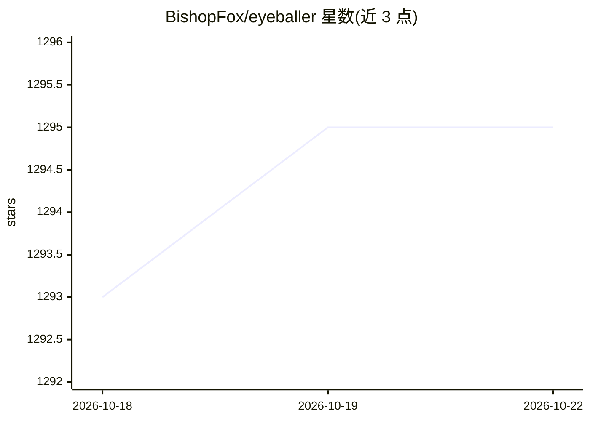

# BishopFox/eyeballer

⭐ 1,295 · Python · GPL-3.0 · 推送 2026-03-08 · [GitHub](https://github.com/BishopFox/eyeballer) · 组织维护

**用卷积神经网络分析渗透测试截图、标注高价值目标的工具**

面向大规模网络渗透测试场景的工具：用 EyeWitness 或 GoWitness 等工具截取 Web 主机截图后，Eyeballer 通过卷积神经网络（TensorFlow）对截图进行多标签分类，标注 Old-Looking Sites、Login Pages、Webapp、Custom 404、Parked Domains 五类标签，帮助测试者筛出更可能存在漏洞的目标。提供预训练权重（GitHub releases）可直接使用，也可用 Kaggle 上的训练数据自行训练；预测结果输出 results.html 与 results.csv 两种格式。截图建议使用 1.6x 宽高比（如 1440x900），否则缩放会影响预测效果。

## 筛选速览

| 维度 | 判定 | 备注 |
|---|---|---|
| AI 角色 | `ai-native` | 本体是模型或模型工具 |
| 许可风险 | `viral` | GPL-3.0 |
| 部署形态 | `library` | 以包/库形式分发 |
| 模型依赖 | — | README 未给出锁定关系 |
| 硬件要求 | — | 无带数字的原话,不猜 |
| 安装摩擦 | `low` | 无编译、无系统依赖或容器化 |
| 成熟度 | — | 结构信号不足 |

## 能力要点

- 五类标签多标签分类：Old-Looking/Login Pages/Webapp/Custom 404/Parked Domains
- 提供预训练权重，开箱即用，无需自行训练
- 训练数据公开于 Kaggle，支持自行训练与评估
- 预测结果同时输出人类可读（results.html）与机器可读（results.csv）格式

## 适用场景

- 大规模渗透测试中从海量截图里快速筛出高价值目标
- 将 Custom 404 与停放域名等无价值页面从攻击范围中剔除
- 用自有截图数据训练适配目标环境的分类模型

## 场景标签

`网络安全` · 领域:学习与行业

## 证据(README 行号)

> L7: Eyeballer is meant for large-scope network penetration tests where you need to find "interesting" targets from a hug
> L84: eyeballer.py --weights YOUR_WEIGHTS.h5 predict YOUR_FILE.png

## 星数曲线

2026-10-18 1,293 → 2026-10-22 1,295（+2）

---
*卡片 v1 · prompt 1.4 · 生成 2026-10-21 · 置信度 high · 依据 README sha `fb888f447e12` · [字段定义](../../DATASET.md)*
