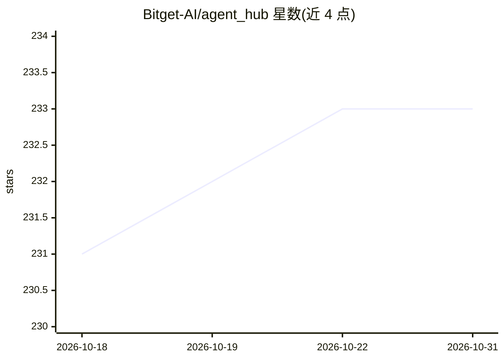

# Bitget-AI/agent_hub

⭐ 233 · JavaScript · MIT · 推送 2026-06-30 · [GitHub](https://github.com/Bitget-AI/agent_hub) · 组织维护

**连接 AI 代理与 Bitget 交易所的官方开源工具集**

Bitget 官方 AI Agent 工具生态的中央入口仓库，由 5 个 MIT 许可的 npm 包组成：TypeScript SDK（89 个 UTA v3 操作、HMAC 签名、限流）、终端 AI 用的 bgc CLI 与技能包、桌面 AI 用的 MCP 服务器，以及无需 API Key 的 5 个市场分析技能（宏观/链上/情绪/技术/新闻）。通过 bitget-agent-installer 元工具一条命令安装、升级、回滚并把技能部署到 Claude Code、Codex、Cursor、ChatGPT 等 AI 工具。面向个人交易者与量化开发者，提供 --read-only 与 --paper-trading 安全模式，API 密钥仅从环境变量读取。

## 筛选速览

| 维度 | 判定 | 备注 |
|---|---|---|
| AI 角色 | `ai-ecosystem` | LLM/agent 周边工具 |
| 许可风险 | `permissive` | MIT |
| 部署形态 | `library` | 以包/库形式分发 |
| 模型依赖 | locked-api |  |
| 硬件要求 | — | 无带数字的原话,不猜 |
| 安装摩擦 | `low` | 无编译、无系统依赖或容器化 |
| 成熟度 | — | 结构信号不足 |

## 能力要点

- 89 个 Bitget UTA v3 操作封装为 14 个意图动词
- 一条 npx 命令安装/升级/回滚全部包并部署技能到各 AI 工具
- bitget-signal 提供 5 个无需账号与 API Key 的市场分析技能
- --read-only 与 --paper-trading 安全模式；密钥仅从环境变量读取、本地 HMAC-SHA256 签名

## 适用场景

- 让 Claude Code / Cursor / ChatGPT 等代理通过自然语言下单、查余额、划转资金
- 用纸面交易模式先练习 AI 下单再接入真实资金
- 无需交易所账号即可让 AI 做加密市场宏观/链上/情绪分析
- 开发者基于 SDK 构建自定义 Bitget 交易工具

## 场景标签

`金融量化` `Agent 框架` · 领域:Agent 开发

## 证据(README 行号)

> L5:  The official open-source toolkit connecting Claude, Cursor, Codex, ChatGPT, and any MCP-compatible AI agent to your
> L58: |`bitget-agent-sdk`|Developers|Foundation TypeScript SDK with 89 UTA v3 operations|
> L60: |`bitget-agent-mcp`|Desktop AI|MCP server for Claude Desktop, Cursor, Windsurf, ChatGPT|

## 星数曲线

2026-10-18 231 → 2026-10-31 233（+2）

---
*卡片 v1 · prompt 1.4 · 生成 2026-10-22 · 置信度 high · 依据 README sha `9f6bc0b5589b` · [字段定义](../../DATASET.md)*
