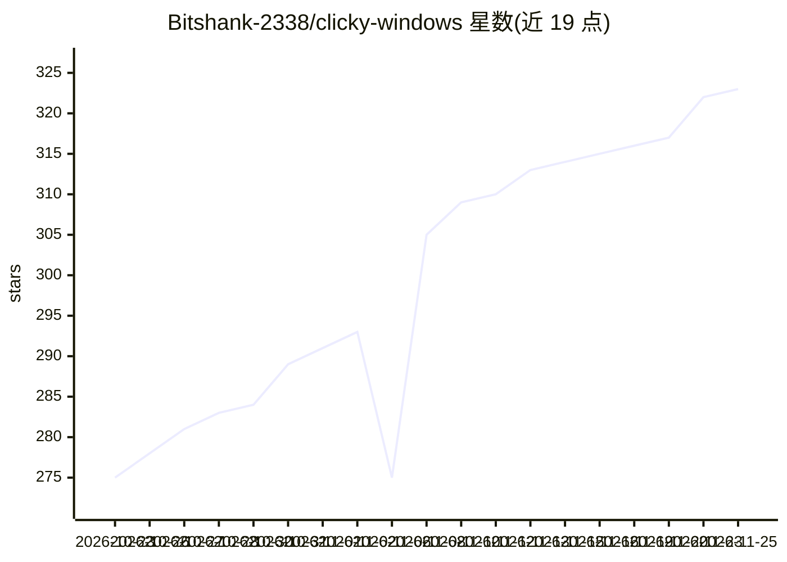

# Bitshank-2338/clicky-windows

⭐ 323 · Python · MIT · 推送 2026-10-26 · [GitHub](https://github.com/Bitshank-2338/clicky-windows) · 个人维护

**Windows 离屏屏 AI 学习助手：读屏、听问题、语音作答并指屏引导**

基于 Python 3.11+ 与 PyQt6 的桌面 AI 助手（farzaa/clicky 的 Windows 移植），常驻光标旁：按住快捷键提问，应用截屏交由视觉 LLM 解答，以光标飞行、白板标注、语音讲解逐步引导。支持 Ollama/LM Studio 本地运行，零 API key 即可使用（默认 qwen2.5vl:3b），也可接入 Claude/OpenAI/Gemini/GitHub Copilot。含语音唤醒、Tesseract OCR、逐应用记忆、SQLite 学习日志与 SM-2 间隔复习、课程录制、可扩展技能系统。

## 筛选速览

| 维度 | 判定 | 备注 |
|---|---|---|
| AI 角色 | `ai-native` | 本体是模型或模型工具 |
| 许可风险 | `permissive` | MIT |
| 部署形态 | `desktop` | 安装包/桌面程序 |
| 模型依赖 | local-ok | 支持本地模型 |
| 硬件要求 | — | 无带数字的原话,不猜 |
| 安装摩擦 | `medium` | 含编译或系统依赖之一 |
| 成熟度 | — | 结构信号不足 |

## 能力要点

- 两阶段网格定位实现像素级指向，兼容任意视觉 LLM
- 支持 Ollama/LM Studio 全离线运行，无需 API key
- 多 Provider 运行时切换：Claude/OpenAI/Copilot/Gemini/本地
- 本地知识日志 + SM-2 间隔复习与测验模式

## 适用场景

- 学习新软件时让助手指屏并逐步讲解操作
- 完全离线环境下用本地模型获得屏幕问答
- 整理学习内容并通过间隔复习巩固知识点

## 场景标签

`AI 助手` `语音识别` `语音 Agent` `OCR` · 领域:对话与助手

## 证据(README 行号)

> L16: Clicky is a little AI buddy that **lives next to your cursor**. Hold a hotkey, ask it something about your screen, 
> L20: Works **100% offline** with Ollama or LM Studio, or plug in your Claude / OpenAI / Gemini / GitHub Copilot key for 
> L74: |**Ollama** (local)|Run `ollama serve` — free, always available|

## 星数曲线

2026-10-23 275 → 2026-11-25 323（+48）

---
*卡片 v1 · prompt 1.4 · 生成 2026-11-25 · 置信度 high · 依据 README sha `571e67eb2298` · [字段定义](../../DATASET.md)*
