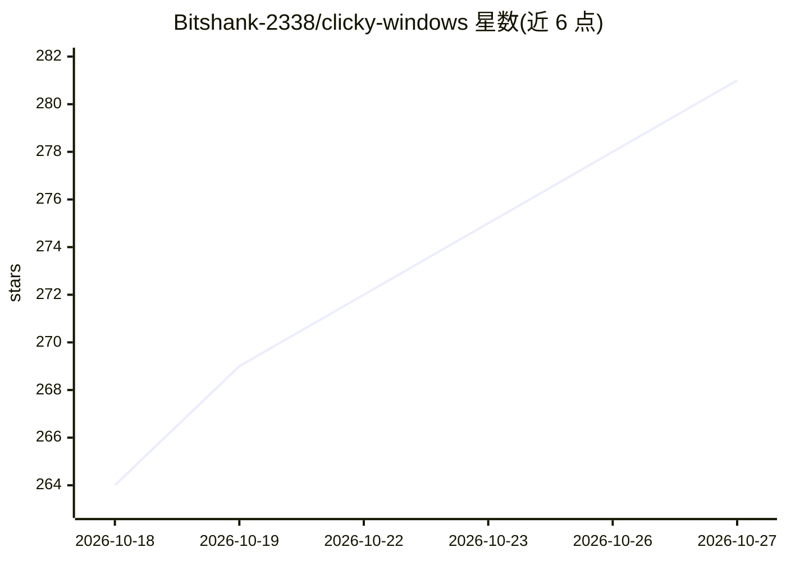

# Bitshank-2338/clicky-windows

⭐ 281 · Python · MIT · 推送 2026-10-26 · [GitHub](https://github.com/Bitshank-2338/clicky-windows) · 个人维护

**常驻光标旁的 Windows 离线 AI 屏幕教学助手**

基于 Python 3.11+/PyQt6 的 Windows 桌面应用，是 macOS 版 farzaa/clicky 的移植。用户按住 Ctrl+Win 语音提问，应用截取多屏截图，由视觉 LLM 理解屏幕内容，用两阶段网格定位（12×8 粗网格+6×6 细网格）让蓝色指针飞到目标处并语音讲解；支持多步教学、屏幕标注、OCR 细读、按应用记忆、SQLite 知识日志与 SM-2 间隔复习。LLM 可在 Claude/OpenAI/Copilot/Gemini 与本地 Ollama/LM Studio 间运行时切换，默认 qwen2.5vl:3b 实现零成本全离线；TTS/STT 亦有多提供方与本地（whisper.cpp/Faster-Whisper）选项。从源码克隆运行，需 Windows 10/11 64-bit。

## 筛选速览

| 维度 | 判定 | 备注 |
|---|---|---|
| AI 角色 | `ai-native` | 本体是模型或模型工具 |
| 许可风险 | `permissive` | MIT |
| 部署形态 | `desktop` | 安装包/桌面程序 |
| 模型依赖 | local-ok | 支持本地模型 |
| 硬件要求 | — | 无带数字的原话,不猜 |
| 安装摩擦 | `medium` | 含编译或系统依赖之一 |
| 成熟度 | — | 结构信号不足 |

## 能力要点

- 两阶段网格定位实现像素级指向，兼容任意视觉 LLM
- 多提供方 LLM 运行时切换，支持 Ollama/LM Studio 全离线零 API key
- 每应用独立会话记忆与 SQLite 知识日志 + SM-2 间隔复习
- 隐私防护：检测密码管理器/银行窗口时跳过截图

## 适用场景

- 学新软件/视频剪辑/编程时让 AI 指着屏幕逐步讲解
- 无 API key 环境下用本地 Ollama 模型获得屏幕问答
- 把每日问答记录为日志并用间隔复习巩固所学

## 场景标签

`AI 助手` · 领域:对话与助手

## 证据(README 行号)

> L14: Clicky is a little AI buddy that **lives next to your cursor**. Hold a hotkey, ask it something about your screen, 
> L18: Works **100% offline** with Ollama or LM Studio, or plug in your Claude / OpenAI / Gemini / GitHub Copilot key for 
> L39: - Full multi-monitor screenshot on every query

## 星数曲线

2026-10-18 264 → 2026-10-27 281（+17）

---
*卡片 v1 · prompt 1.4 · 生成 2026-10-22 · 置信度 high · 依据 README sha `273bb2764b9b` · [字段定义](../../DATASET.md)*
