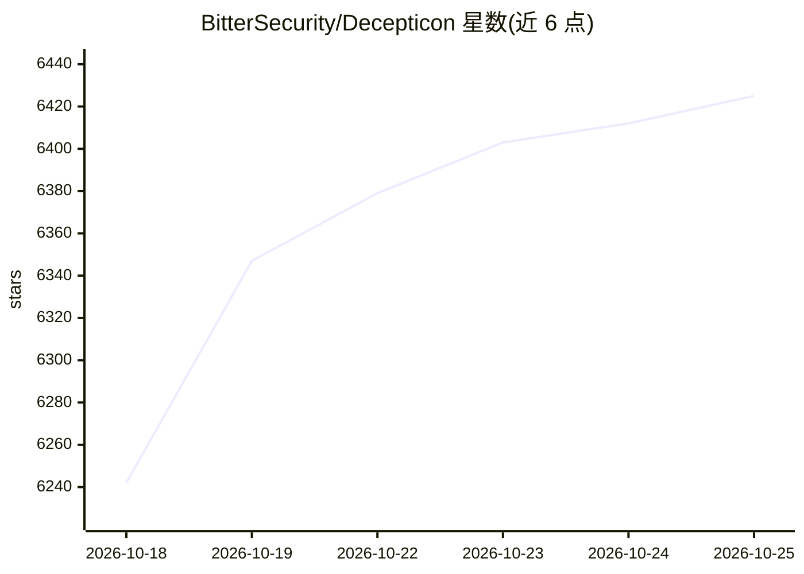

# BitterSecurity/Decepticon

⭐ 6,425 · Python · Apache-2.0 · 推送 2026-10-24 · [GitHub](https://github.com/BitterSecurity/Decepticon) · [官网](https://decepticon.red) · 组织维护

**自主红队攻防 agent：执行侦察到利用的完整攻击链**

面向授权渗透测试的红队自主 agent：输入目标 URL 后按 OPPLAN 执行侦察、漏洞研究、利用、提权、横向移动与 C2，共 16 个专项 agent，命令在独立 Kali 沙箱（双网络隔离）内的 tmux 会话中运行，可选 Ghidra 逆向工作负载与本地防御监控（Blue Cell）。LLM 接入支持多供应商分层回退链（含 Ollama 本地），基于 LangGraph 编排，可用 Docker 脚本安装或 pip 装 SDK，另有云端托管版。要求操作者批准目标与 RoE，禁止未授权使用。

## 筛选速览

| 维度 | 判定 | 备注 |
|---|---|---|
| AI 角色 | `ai-native` | 本体是模型或模型工具 |
| 许可风险 | `permissive` | Apache-2.0 |
| 部署形态 | `self-host` | docker 或自建部署 |
| 模型依赖 | local-ok | 支持本地模型 |
| 硬件要求 | — | 无带数字的原话,不猜 |
| 安装摩擦 | `low` | 无编译、无系统依赖或容器化 |
| 成熟度 | — | 结构信号不足 |

## 能力要点

- 16 个专项 agent 按攻击链阶段组织，独立 Kali 沙箱双网络隔离执行
- 命令运行于持久 tmux 会话，支持交互式工具的自动跟进
- 多供应商分层凭据回退链，含 Ollama 本地与订阅 OAuth
- pip SDK 形式提供 agent 工厂、中间件、工具与插件接口

## 适用场景

- 在授权范围内执行自主红队渗透测试
- 对发现的二进制文件做 Ghidra 深度逆向分析
- 渗透同时用本地传感器监测并报告可疑事件
- 作为库构建自定义编排器或研究集成

## 场景标签

`网络安全` `Agent 框架` · 领域:Agent 开发

## 证据(README 行号)

> L154: **Decepticon is a professional autonomous Red Team agent.** It executes realistic attack chains — reconnaissance, 
> L196: **Tier-mapped providers**: Anthropic, OpenAI, Google Gemini, MiniMax, DeepSeek, xAI, Mistral, OpenRouter, Nvidia N

## 星数曲线

2026-10-18 6,242 → 2026-10-25 6,425（+183）

---
*卡片 v1 · prompt 1.4 · 生成 2026-10-20 · 置信度 high · 依据 README sha `23b24a18b9e2` · [字段定义](../../DATASET.md)*
