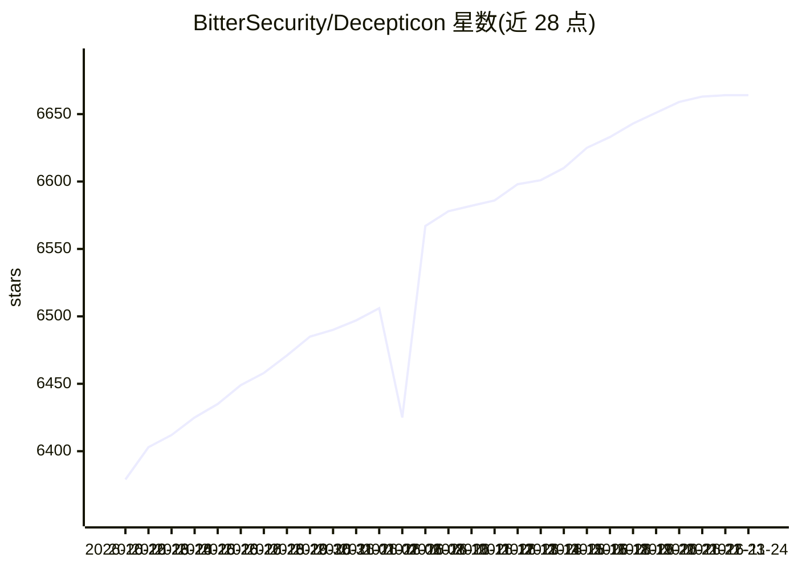

# BitterSecurity/Decepticon

⭐ 6,676 · Python · Apache-2.0 · 推送 2026-11-19 · [GitHub](https://github.com/BitterSecurity/Decepticon) · [官网](https://decepticon.red) · 组织维护

**自主红队攻击链 Agent：侦察到提权横移全流程执行**

以 Docker 栈交付的自主渗透测试 Agent：按杀伤链阶段组织 16 个专职 Agent，读取 OPPLAN 并在 Kali Linux 沙箱（独立 sandbox-net 网络）内执行命令，通过 tmux 持久会话驱动 msfconsole、sliver-client 等交互式工具。管理面常驻 LiteLLM、PostgreSQL、Neo4j、LangGraph，BloodHound CE、Sliver C2 等专用负载按需由编排器拉起。提供终端 CLI、pip 客户端 SDK（需指向运行时服务）与 MCP server 接入 Claude Code/Codex。需操作者批准目标与 RoE；托管版 Web 控制台属云产品。

## 筛选速览

| 维度 | 判定 | 备注 |
|---|---|---|
| AI 角色 | `ai-native` | 本体是模型或模型工具 |
| 许可风险 | `permissive` | Apache-2.0 |
| 部署形态 | `self-host` | docker 或自建部署 |
| 模型依赖 | local-ok | 支持本地模型 |
| 硬件要求 | — | 无带数字的原话,不猜 |
| 安装摩擦 | `low` | 无编译、无系统依赖或容器化 |
| 成熟度 | — | 结构信号不足 |

## 能力要点

- 16 个按杀伤链阶段划分的专职 Agent，每个目标独立上下文窗口
- tmux 持久交互式会话与自动提示检测，支持 msfconsole/sliver 等 C2 工具
- 双网络隔离架构：管理面与 Kali 沙箱面分离
- 分层模型配置（eco/max/test）与凭证感知的 provider 回退链

## 适用场景

- 对已授权目标执行侦察、利用、提权到横移的完整攻击链
- 作为 SDK 构建自定义编排器或研究集成
- 通过 MCP server 在 Claude Code/Codex 中调用红队能力
- 用 XBOW 基准评测 AI 渗透 Agent 的表现

## 场景标签

`网络安全` `模型评测` · 领域:评测与运维

## 证据(README 行号)

> L152: **Decepticon is a professional autonomous Red Team agent.** It executes realistic attack chains — reconnaissance, 
> L162: **Interactive shells, actually.** Real offensive tools are interactive (`msfconsole`, `sliver-client`, `evil-winrm
> L178: 16 specialist agents organized by kill chain phase, with a fresh context window per objective — no accumulated noi

## 星数曲线

2026-10-22 6,379 → 2026-11-24 6,664（+285）

---
*卡片 v1 · prompt 1.4 · 生成 2026-11-22 · 置信度 high · 依据 README sha `4f395ef9dc6e` · [字段定义](../../DATASET.md)*
