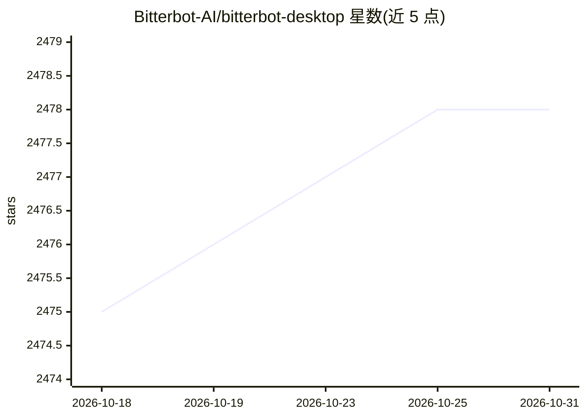

# Bitterbot-AI/bitterbot-desktop

⭐ 2,478 · TypeScript · MIT · 推送 2026-10-30 · [GitHub](https://github.com/Bitterbot-AI/bitterbot-desktop) · [官网](https://bitterbot.ai) · 组织维护

**本地优先的个人 AI agent：持久记忆+技能学习+多渠道对话**

运行在用户本机的开源个人 agent（MIT 许可）：跨对话保留记忆，通过 Control UI、WhatsApp、Telegram、Discord、Signal、Slack 或邮件对话，可调用浏览器自动化、代码执行与定时任务。核心机制包括：基于文件与 SQLite 的可检查记忆（事实账本、知识图谱、Deep Recall）、每 2 小时运行的 Dream Engine 整理记忆，以及技能进化流水线——生成的技能须在留出任务上通过确定性测试并积累统计证据方可晋升，可回滚。Circles 支持与他人的独立 agent 互联。安装提供一键脚本、npm、Docker 与源码四种方式；Windows 需经 WSL2。

## 筛选速览

| 维度 | 判定 | 备注 |
|---|---|---|
| AI 角色 | `ai-native` | 本体是模型或模型工具 |
| 许可风险 | `permissive` | MIT |
| 部署形态 | `self-host` | docker 或自建部署 |
| 模型依赖 | local-ok | 支持本地模型 |
| 硬件要求 | — | 无带数字的原话,不猜 |
| 安装摩擦 | `low` | 无编译、无系统依赖或容器化 |
| 成熟度 | — | 结构信号不足 |

## 能力要点

- 记忆以文件与 SQLite 存于本机，可检查、备份、更正
- Dream Engine 提供 11 种后台记忆整理模式（默认每 2 小时）
- 技能进化流水线：候选技能须通过留出任务测试与统计证据方可晋升
- 支持 WhatsApp/Telegram/Discord/Signal/Slack/邮件等多渠道接入

## 适用场景

- 让 agent 记住跨会话的项目上下文与个人偏好
- 通过已有的聊天软件与自己的 agent 协作完成长周期任务
- 查看并干预 agent 的记忆与习得技能

## 场景标签

`AI 助手` `Agent 记忆` `浏览器自动化` · 领域:Agent 开发

## 证据(README 行号)

> L27: Bitterbot runs on your machine, remembers context across conversations, and works through a real browser, code exec
> L33: Meta's Muse and OpenAI's dots made the persistent personal agent mainstream: an AI that remembers you and keeps wor

## 星数曲线

2026-10-18 2,475 → 2026-10-31 2,478（+3）

---
*卡片 v1 · prompt 1.4 · 生成 2026-10-21 · 置信度 high · 依据 README sha `b1b4387cfafe` · [字段定义](../../DATASET.md)*
