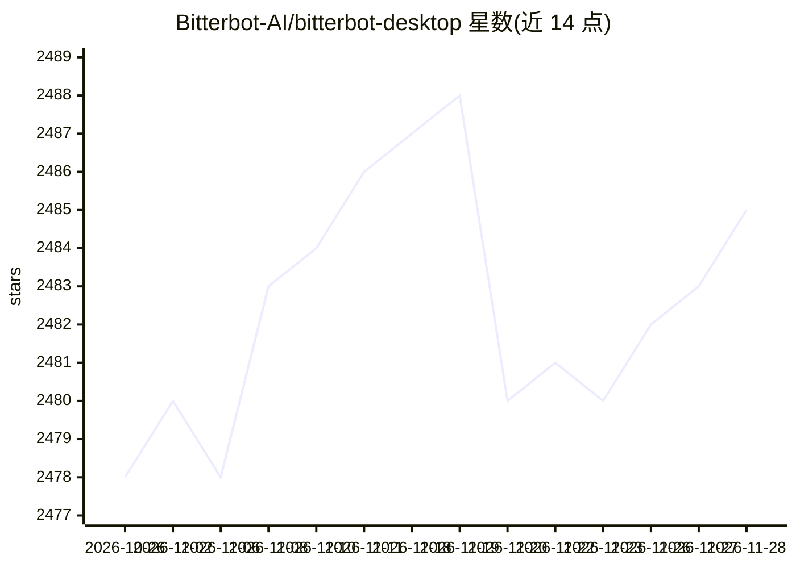

# Bitterbot-AI/bitterbot-desktop

⭐ 2,485 · TypeScript · MIT · 推送 2026-11-27 · [GitHub](https://github.com/Bitterbot-AI/bitterbot-desktop) · [官网](https://bitterbot.ai) · 组织维护

**本地优先的个人 AI agent：持久记忆、Dream Engine 与可验证技能学习**

MIT 许可的开源桌面/服务器端个人 agent，运行在用户自己的机器上，跨会话保留记忆，通过 Control UI、WhatsApp、Telegram、Discord、Signal、Slack、邮件等多渠道对话，并具备浏览器自动化、代码执行、定时任务等能力。关键机制包括：基于文件与 SQLite 的可检视记忆（canonical-facts 账本、语义检索、知识图谱）、每 2 小时默认运行的 Dream Engine 后台记忆整理循环，以及技能进化流水线——生成的技能须经保留任务评估、金丝雀发布与回归监控后才被提升。安装提供一键脚本、npm、Docker 与源码路径，运行需配置模型 key。

## 筛选速览

| 维度 | 判定 | 备注 |
|---|---|---|
| AI 角色 | `ai-native` | 本体是模型或模型工具 |
| 许可风险 | `permissive` | MIT |
| 部署形态 | `self-host` | docker 或自建部署 |
| 模型依赖 | — | README 未给出锁定关系 |
| 硬件要求 | — | 无带数字的原话,不猜 |
| 安装摩擦 | `low` | 无编译、无系统依赖或容器化 |
| 成熟度 | — | 结构信号不足 |

## 能力要点

- 文件 + SQLite 存储的持久记忆，含语义检索、知识图谱与 Deep Recall
- Dream Engine 每 2 小时运行记忆压缩、模拟、蒸馏等 11 种模式
- 技能进化流水线：候选技能经保留任务与统计证据检验后才提升
- 多渠道接入（Control UI/WhatsApp/Telegram/Discord/Slack/邮件）与浏览器自动化、定时任务

## 适用场景

- 在本地运行一个记住项目背景的个人 AI 助手
- 让 agent 定时汇总任务并通过 Telegram 发送报告
- 与朋友互相连接各自拥有的 agent 组成 Circles

## 场景标签

`Agent 记忆` `浏览器自动化` `AI 助手` `聊天机器人` · 领域:Agent 开发

## 证据(README 行号)

> L6:  A personal agent with living memory, a dream engine, and skills that have to prove themselves.
> L27: Bitterbot runs on your machine, remembers context across conversations, and works through a real browser, code exec
> L31: Your agent's memory, identity, and skills live in files and SQLite on your disk. Inspect them. Back them up. Choose

## 星数曲线

2026-10-26 2,478 → 2026-11-28 2,485（+7）

---
*卡片 v1 · prompt 1.4 · 生成 2026-11-28 · 置信度 high · 依据 README sha `062158891f65` · [字段定义](../../DATASET.md)*
