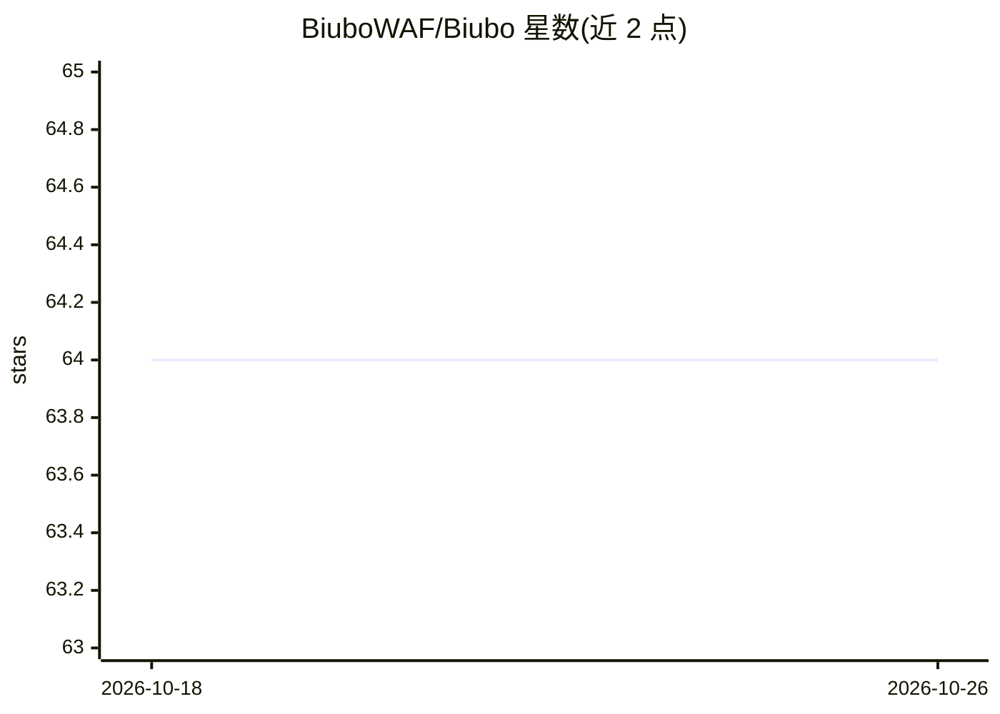

# BiuboWAF/Biubo

⭐ 64 · HTML · MIT · 推送 2026-04-10 · [GitHub](https://github.com/BiuboWAF/Biubo) · [官网](https://biubo.zplb.org.cn) · 组织维护

**AI 驱动的 Web 应用防火墙，支持攻击会话可视化回放**

以反向代理形态部署在 Web 应用前方的防火墙：对每个请求执行双路检测——正则快速路径与 LLM 语义深路径，命中后隔离来源 IP。集成 rrweb 记录并回放恶意会话，提供实时攻击地图与流量仪表盘；内置 Msgpack 自包含存储，无需 SQL/Redis/Nginx 配置。另含 JS 挑战应对无头机器人。面向需要部署 WAF 的运维与开发者，通过源码 clone 或 Docker 运行。

## 筛选速览

| 维度 | 判定 | 备注 |
|---|---|---|
| AI 角色 | `ai-enhanced` | 去掉 AI 部分产品仍成立 |
| 许可风险 | `permissive` | MIT |
| 部署形态 | `self-host` | docker 或自建部署 |
| 模型依赖 | — | README 未给出锁定关系 |
| 硬件要求 | — | 无带数字的原话,不猜 |
| 安装摩擦 | `low` | 无编译、无系统依赖或容器化 |
| 成熟度 | — | 结构信号不足 |

## 能力要点

- 双路检测：正则快速路径 + LLM 语义深路径
- 集成 rrweb 记录并回放恶意会话
- 实时全球攻击地图与流量仪表盘
- 自包含 Msgpack 存储，无需 SQL/Redis/Nginx

## 适用场景

- 在 Web 应用前部署带语义检测能力的防火墙
- 攻击发生后回放攻击者的完整会话操作
- 实时监控攻击来源与流量态势

## 场景标签

`网络安全` · 领域:学习与行业

## 证据(README 行号)

> L15: **Biubo WAF** is not just another rule-based filter. It is an **Intelligence-First Proxy** that bridges the gap bet
> L39: |**Dual-Path Detection**|Regex (Fast Path) + LLM (Deep Path) for maximum coverage.|✅|

## 星数曲线

2026-10-18 64 → 2026-10-26 64（+0）

---
*卡片 v1 · prompt 1.4 · 生成 2026-10-24 · 置信度 high · 依据 README sha `ab66d913275e` · [字段定义](../../DATASET.md)*
