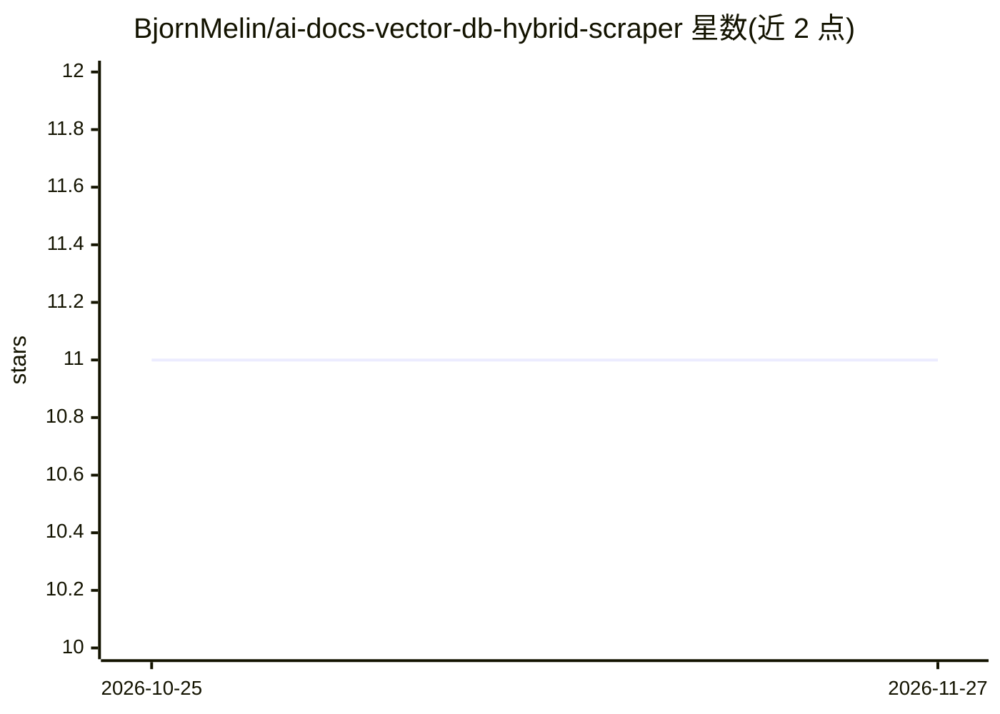

# BjornMelin/ai-docs-vector-db-hybrid-scraper

⭐ 11 · Python · MIT · 推送 2026-07-16 · [GitHub](https://github.com/BjornMelin/ai-docs-vector-db-hybrid-scraper) · 个人维护

**面向 AI 工程师的文档采集与向量检索/RAG 基础栈**

结合 Firecrawl 与 Crawl4AI 采集文档，生成稠密与稀疏嵌入存入 Qdrant，通过 FastAPI 与 FastMCP 双接口提供混合检索与 RAG 构建模块。模式化配置区分个人开发者与企业功能集；内置分块策略矩阵、HyDE 查询扩展、重排序钩子、SlowAPI 限流、OpenTelemetry/Prometheus 可观测性与健康检查。运行需 Python 3.11、uv 与 Qdrant 实例；OpenAI/Firecrawl 按启用项提供 API key。

## 筛选速览

| 维度 | 判定 | 备注 |
|---|---|---|
| AI 角色 | `ai-ecosystem` | LLM/agent 周边工具 |
| 许可风险 | `permissive` | MIT |
| 部署形态 | `self-host` | docker 或自建部署 |
| 模型依赖 | — | README 未给出锁定关系 |
| 硬件要求 | — | 无带数字的原话,不猜 |
| 安装摩擦 | `low` | 无编译、无系统依赖或容器化 |
| 成熟度 | — | 结构信号不足 |

## 能力要点

- 多层级采集编排：HTTP、Crawl4AI、Playwright、Firecrawl 等适配器，含可续传的批量嵌入 CLI
- 稠密+稀疏混合检索，可切换 dense/sparse/hybrid 模式，支持 HyDE 与重排序
- FastAPI REST 与 FastMCP 服务器双接口，注册检索、文档管理与分析工具供 Claude Desktop/Code 使用
- OpenTelemetry 追踪、Prometheus /metrics、Dragonfly 缓存与集中式健康检查

## 适用场景

- 为团队文档站点建立可复现的向量检索与 RAG 管线
- 通过 MCP 让 Claude Desktop/Code 调用文档搜索工具
- 批量抓取并嵌入文档库到 Qdrant，支持断点续传
- 为 agent 或应用提供统一的检索集成点

## 场景标签

`RAG` `网页抓取` · 领域:效率与自动化

## 证据(README 行号)

> L7: AI-focused documentation ingestion and retrieval stack that combines Firecrawl and
> L16: stores them in Qdrant, and serves hybrid search and RAG building blocks. It is
> L30: - Dual interfaces: REST endpoints in FastAPI (`src/api/routers/v1/`) and a

## 星数曲线

2026-10-25 11 → 2026-11-27 11（+0）

---
*卡片 v1 · prompt 1.4 · 生成 2026-11-19 · 置信度 mid · 依据 README sha `e33348059f39` · [字段定义](../../DATASET.md)*
