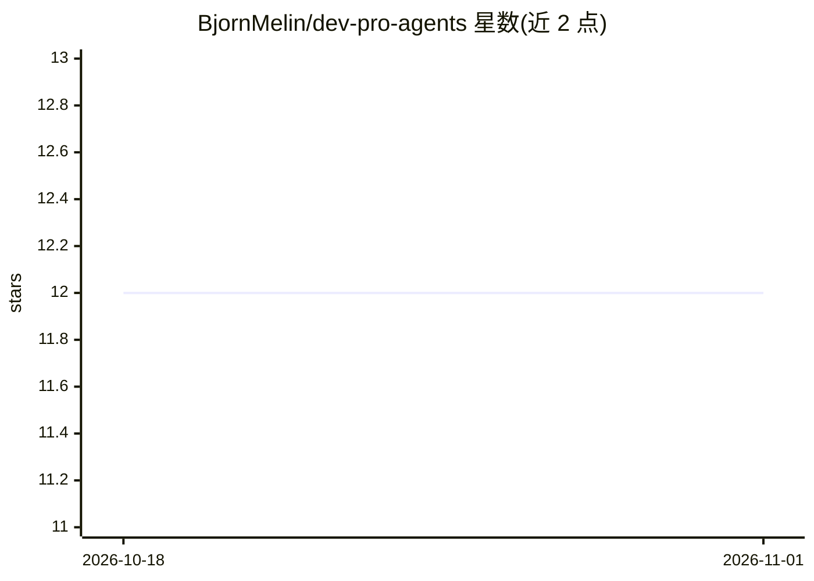

# BjornMelin/dev-pro-agents

⭐ 12 · Python · MIT · 推送 2026-08-08 · [GitHub](https://github.com/BjornMelin/dev-pro-agents) · 个人维护

**多智能体编排框架：JSON 任务简报生成经验证的实施交接**

基于 LangGraph 与 LangChain v1 的多智能体编排库：协调器将规划与验证委托给两个角色工具，用 Pydantic 校验输出，并通过 LangGraph 原生 SQLite saver 持久化检查点。v0.1 刻意限定为只读，无仓库写入、子进程、shell、浏览器与网络工具。以 CLI 与 Python 库形式提供，默认模型 openai:gpt-5-mini，可用 --model 覆盖或注入任意 BaseChatModel；尚未发布到 PyPI。

## 筛选速览

| 维度 | 判定 | 备注 |
|---|---|---|
| AI 角色 | `ai-ecosystem` | LLM/agent 周边工具 |
| 许可风险 | `permissive` | MIT |
| 部署形态 | `library` | 以包/库形式分发 |
| 模型依赖 | — | README 未给出锁定关系 |
| 硬件要求 | — | 无带数字的原话,不猜 |
| 安装摩擦 | `low` | 无编译、无系统依赖或容器化 |
| 成熟度 | — | 结构信号不足 |

## 能力要点

- 严格 JSON 任务简报输入，Pydantic 校验输出实施交接
- LangGraph SQLite 检查点持久化，支持 --thread-id 续接会话
- v0.1 为只读边界：无仓库变更/子进程/浏览器/网络工具
- 模型与检查点可注入，测试无需真实凭据

## 适用场景

- 用 CLI 从任务简报生成经验证的开发实施计划
- 作为库嵌入自己的智能体工作流并自定义模型
- 通过检查点续接多轮规划会话

## 场景标签

`Agent 框架` `多智能体` · 领域:Agent 开发

## 证据(README 行号)

> L3: `dev-pro-agents` turns a strict JSON task brief into a validated implementation handoff. Its
> L4: LangChain v1 coordinator delegates planning and verification to two direct role tools, validates

## 星数曲线

2026-10-18 12 → 2026-11-01 12（+0）

---
*卡片 v1 · prompt 1.4 · 生成 2026-11-01 · 置信度 mid · 依据 README sha `42ce86ba03f7` · [字段定义](../../DATASET.md)*
