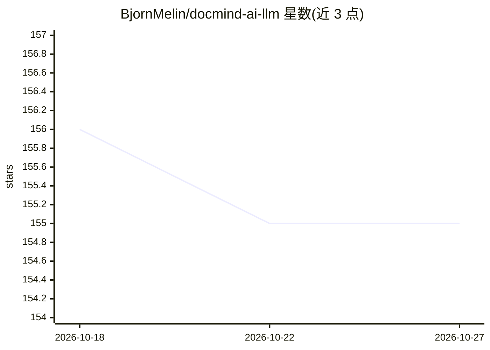

# BjornMelin/docmind-ai-llm

⭐ 155 · Python · MIT · 推送 2026-08-19 · [GitHub](https://github.com/BjornMelin/docmind-ai-llm) · [官网](https://github.com/BjornMelin/docmind-ai-llm) · 个人维护

**本地优先的文档分析应用：本地 LLM 加持的解析、检索与多智能体问答**

基于 Streamlit 的本地优先文档分析应用：Docling/pypdfium2/RapidOCR 解析多格式文档，LlamaIndex 管道做稠密+稀疏混合检索（Qdrant 服务端 RRF/DBSF 融合、BGE 与 SigLIP 重排），LangGraph supervisor 编排 planner/retrieval/synthesis/validation 四个 agent，支持可选 GraphRAG 与多模态页面检索。LLM 后端默认 Ollama，可选 vLLM、LM Studio、llama.cpp；远程端点默认阻断。面向重视隐私的本地部署用户，Linux x86_64 为验证平台，需 Python 3.12+、uv 安装，Docker Compose 可选。

## 筛选速览

| 维度 | 判定 | 备注 |
|---|---|---|
| AI 角色 | `ai-native` | 本体是模型或模型工具 |
| 许可风险 | `permissive` | MIT |
| 部署形态 | `self-host` | docker 或自建部署 |
| 模型依赖 | local-ok | 支持本地模型 |
| 硬件要求 | — | 无带数字的原话,不猜 |
| 安装摩擦 | `low` | 无编译、无系统依赖或容器化 |
| 成熟度 | — | 结构信号不足 |

## 能力要点

- 本地优先：远程 LLM 端点默认阻断，需显式开启
- 混合检索路由（语义/混合/关键词/多模态/知识图）+ Qdrant 服务端融合
- LangGraph supervisor 编排四个 agent 的多智能体分析
- Docling/RapidOCR/pypdfium2 的 CPU 安全多格式解析管道

## 适用场景

- 在本地离线分析 PDF 与办公文档并生成摘要
- 对图像密集型 PDF 做以图搜图的视觉检索
- 私有环境下搭建带混合检索与多 agent 的文档问答

## 场景标签

`文档问答` `多智能体` `语义搜索` · 领域:Agent 开发

## 证据(README 行号)

> L14: **DocMind AI** is a local-first document analysis application. It combines dense and sparse retrieval, optional Gra
> L33: - **Multi-agent coordination:** LangGraph supervisor orchestrates four agents (planner, retrieval, synthesis, valid
> L53: - One supported LLM backend running locally: Ollama (default), vLLM OpenAI-compatible server, LM Studio, or a llama

## 星数曲线

2026-10-18 156 → 2026-10-27 155（-1）

---
*卡片 v1 · prompt 1.4 · 生成 2026-10-22 · 置信度 high · 依据 README sha `ea7200df4013` · [字段定义](../../DATASET.md)*
