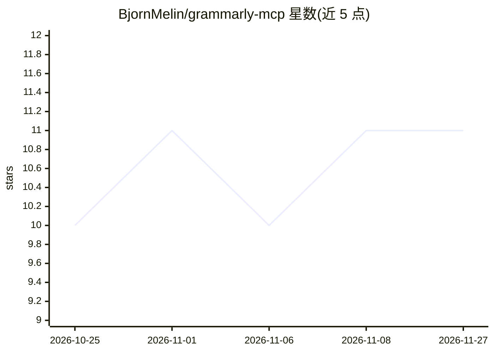

# BjornMelin/grammarly-mcp

⭐ 11 · TypeScript · MIT · 推送 2026-01-14 · [GitHub](https://github.com/BjornMelin/grammarly-mcp) · 个人维护

**MCP server：经浏览器自动化获取 Grammarly AI 检测与抄袭评分并用 Claude 改写文本**

单工具 MCP server，通过 Stagehand + Browserbase（默认）或 Browser Use Cloud（备用）自动化 Grammarly 网页界面，获取 AI 检测与抄袭百分比，并调用 Claude 改写文本以降低 AI 检测分数。不使用 Grammarly API，需要 Grammarly Pro 账号与浏览器自动化服务账号。支持会话持久化、自愈式自动化、双 LLM 通道（浏览器自动化与文本改写分别配置）、动作缓存与 JSON/markdown 输出，以 stdio 传输供 MCP 客户端调用。

## 筛选速览

| 维度 | 判定 | 备注 |
|---|---|---|
| AI 角色 | `ai-ecosystem` | LLM/agent 周边工具 |
| 许可风险 | `permissive` | MIT |
| 部署形态 | `library` | 以包/库形式分发 |
| 模型依赖 | — | README 未给出锁定关系 |
| 硬件要求 | — | 无带数字的原话,不猜 |
| 安装摩擦 | `low` | 无编译、无系统依赖或容器化 |
| 成熟度 | — | 结构信号不足 |

## 能力要点

- 暴露单一 MCP 工具 grammarly_optimize_text，支持 score_only/optimize/analyze 三种模式
- 双浏览器自动化 provider：Stagehand + Browserbase（默认）与 Browser Use Cloud（备用）
- 浏览器自动化与文本改写可分别配置 LLM provider（Claude Code/OpenAI/Google/Anthropic）
- 提供交互式配置脚本，覆盖 Claude Code/Claude Desktop/Cursor/VS Code/Windsurf/Gemini CLI 等 8 种客户端配置示例

## 适用场景

- 在 MCP 客户端中调用工具获取文本的 AI 检测与抄袭评分
- 通过迭代改写将文本 AI 检测分数压到目标阈值以下
- 按语气（正式/学术等）与领域提示定制改写输出

## 场景标签

`浏览器自动化` `AI 写作` · 领域:效率与自动化

## 证据(README 行号)

> L1: # Grammarly MCP Server
> L3: Single-tool Model Context Protocol (MCP) server for AI detection and plagiarism scoring via Grammarly's web interfac
> L9: - Exposes one MCP tool: `grammarly_optimize_text`

## 星数曲线

2026-10-25 10 → 2026-11-27 11（+1）

---
*卡片 v1 · prompt 1.4 · 生成 2026-11-19 · 置信度 high · 依据 README sha `006b236b1892` · [字段定义](../../DATASET.md)*
