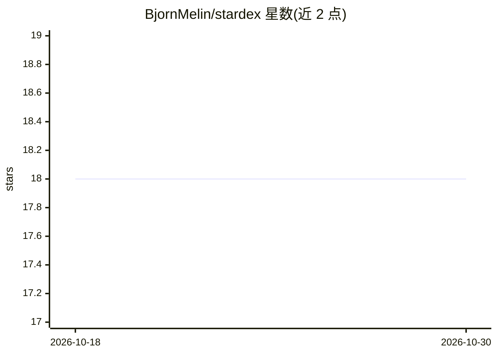

# BjornMelin/stardex

⭐ 18 · TypeScript · MIT · 推送 2026-07-16 · [GitHub](https://github.com/BjornMelin/stardex) · 个人维护

**按描述相似度聚类 GitHub star 仓库的 Web 应用**

Next.js 前端 + FastAPI 后端的单仓双服务应用：从 GitHub REST API 拉取一个或多个用户的 starred 仓库，支持语言/主题/最低星数过滤与排序，后端用 TF-IDF 向量化仓库描述并提供 K-means、层次聚类、PCA+层次聚类三种算法，参数可在 UI 调节。聚类 API 对 1-1000 个仓库有效，超过 250 个仅返回 K-means。面向想在自有 star 列表中发现模式、寻找 good first issue 的开发者，本地需 Node.js+pnpm 与 Python 3.11+（uv）。

## 筛选速览

| 维度 | 判定 | 备注 |
|---|---|---|
| AI 角色 | `ai-native` | 本体是模型或模型工具 |
| 许可风险 | `permissive` | MIT |
| 部署形态 | `library` | 以包/库形式分发 |
| 模型依赖 | — | README 未给出锁定关系 |
| 硬件要求 | — | 无带数字的原话,不猜 |
| 安装摩擦 | `low` | 无编译、无系统依赖或容器化 |
| 成熟度 | — | 结构信号不足 |

## 能力要点

- TF-IDF 向量化 + K-means/层次聚类/PCA 三种算法，UI 可调参
- 多用户 starred 仓库聚合，支持语言、主题、最低星数过滤
- 列表内发起 good first issue / help wanted 的仓库级搜索
- 后端含输入校验（数量、体积、参数范围限制）

## 适用场景

- 整理自己积累的大量 GitHub star，按主题聚类浏览
- 比较多个开发者的关注方向
- 在 star 过的仓库里找可贡献的入门 issue

## 场景标签

 · 领域:开发者工具/数据分析

## 证据(README 行号)

> L22: - Cluster repositories by description similarity using K-means, hierarchical clustering, or PCA + hierarchical clus
> L47: 3. The backend vectorizes repository text (description/name) using TF-IDF and runs one or more clustering algorithm

## 星数曲线

2026-10-18 18 → 2026-10-30 18（+0）

---
*卡片 v1 · prompt 1.4 · 生成 2026-10-29 · 置信度 high · 依据 README sha `29af59337c51` · [字段定义](../../DATASET.md)*
