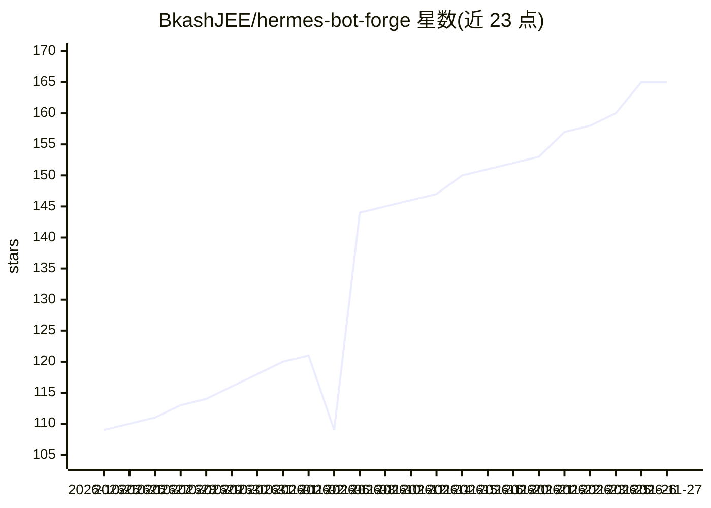

# BkashJEE/hermes-bot-forge

⭐ 165 · Python · MIT · 推送 2026-11-13 · [GitHub](https://github.com/BkashJEE/hermes-bot-forge) · [官网](https://github.com/BkashJEE/hermes-bot-forge) · 个人维护

**Hermes 插件：一句话让 agent 生成完整可用的 Bot**

Bot Forge 是 Hermes Agent 的插件，用户在聊天中描述任务（如 "make me a bot"），agent 即调用 create_agent 工具生成一个完整 Bot：包括唯一名称与形象、为其编写的 SOUL.md、记忆、工具与技能、可选 cron 例程及网关。提供 15 个工具（create_agent/update_agent/list_agents 等），按 profile 启用，支持共享策略文件统一注入各 Bot 系统提示（提示文本而非强制执行），含 Bot 删除保护与备份机制。依赖 Hermes Agent 0.21+，Linux/macOS/Windows 测试通过，Windows 部分功能跳过。

## 筛选速览

| 维度 | 判定 | 备注 |
|---|---|---|
| AI 角色 | `ai-ecosystem` | LLM/agent 周边工具 |
| 许可风险 | `permissive` | MIT |
| 部署形态 | `None` |  |
| 模型依赖 | local-ok | 支持本地模型 |
| 硬件要求 | — | 无带数字的原话,不猜 |
| 安装摩擦 | `low` | 无编译、无系统依赖或容器化 |
| 成熟度 | — | 结构信号不足 |

## 能力要点

- 一句话生成完整 Bot：身份、SOUL.md、记忆、工具、例程、网关
- 15 个聊天驱动的工具，含共享策略注入与 staleness 审计
- 删除保护：默认禁用删除、删除前导出 .tar.gz 备份
- 支持 API key、本地模型与 OAuth 登录三种模型接入方式

## 适用场景

- 为持久性任务快速生成一个专职 Bot（如社媒写作）
- 通过共享策略文件统一管理多个 Bot 的行为规则
- 在 Hermes roster 中复用现有 Bot 或按需生成新 Bot

## 场景标签

`Agent 框架` `多智能体` · 领域:Agent 开发

## 证据(README 行号)

> L18: Bot Forge is a Hermes Agent plugin that lets any agent spawn a complete, working Bot Mode Bot from one sentence — n
> L58: - Hermes Agent **0.21+** with the `hermes` CLI on your `PATH`
> L114: Or ask your agent: *"what tools do you have for creating agents?"* — it should name `create_agent`, `update_agent`

## 星数曲线

2026-10-25 109 → 2026-11-27 165（+56）

---
*卡片 v1 · prompt 1.4 · 生成 2026-11-27 · 置信度 high · 依据 README sha `1222a4438078` · [字段定义](../../DATASET.md)*
