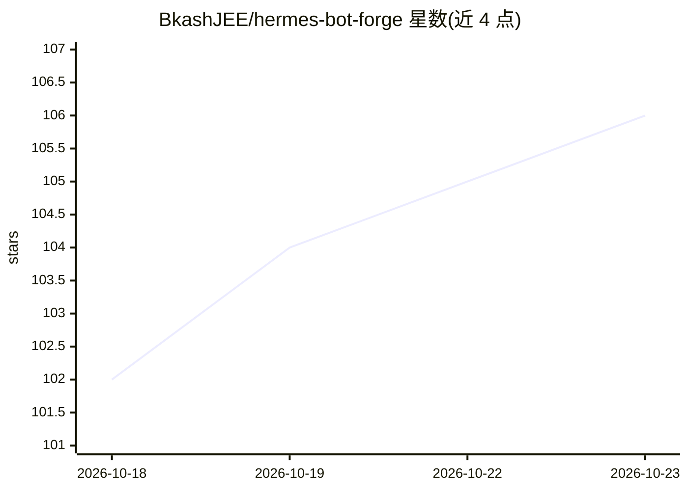

# BkashJEE/hermes-bot-forge

⭐ 106 · Python · MIT · 推送 2026-10-18 · [GitHub](https://github.com/BkashJEE/hermes-bot-forge) · [官网](https://github.com/BkashJEE/hermes-bot-forge) · 个人维护

**Hermes Agent 插件：一句话生成完整可用的 Bot（身份/记忆/工具/网关）**

面向 Hermes Agent 用户的插件，通过 `hermes plugins install` 安装后，用户对 agent 说 'make me a <role>' 即可让 agent 调用 create_agent 生成一个完整 Bot：专属名称、blob 头像、由 agent 撰写的 SOUL.md、起始记忆、文件/web/浏览器工具、可选 cron 例程与运行中的网关。提供共享策略文件（BOT-POLICY.md）一次编辑同步所有 Bot、策略漂移检查、本地模型探测回退、删除前备份等机制。要求 Hermes Agent 0.21+，仅测试 Linux 与 macOS，Windows 不受支持。

## 筛选速览

| 维度 | 判定 | 备注 |
|---|---|---|
| AI 角色 | `ai-ecosystem` | LLM/agent 周边工具 |
| 许可风险 | `permissive` | MIT |
| 部署形态 | `None` |  |
| 模型依赖 | local-ok | 支持本地模型 |
| 硬件要求 | — | 无带数字的原话,不猜 |
| 安装摩擦 | `low` | 无编译、无系统依赖或容器化 |
| 成熟度 | `idea` | |

## 能力要点

- 一句话创建含身份/SOUL.md/记忆/工具/例程/网关的完整 Bot
- 共享策略文件一次编辑同步全部 Bot，check_policies 报告漂移
- 新 Bot 模型路由支持 API key、本地模型（llama.cpp/Ollama/LM Studio）与 OAuth 登录状态处理
- 删除默认关闭，删除前导出 .tar.gz 备份

## 适用场景

- 在 Hermes 中按一句话快速创建承担持久职责的新 Bot
- 统一维护整个 Bot 团队的行为策略并追踪漂移
- 为新 Bot 配置本地模型或回退模型路由

## 场景标签

`Agent 框架` · 领域:Agent 开发

## 证据(README 行号)

> L18: Bot Forge is a Hermes Agent plugin that lets any agent spawn a complete, working Bot Mode Bot from one sentence — n
> L13: hermes plugins install bot-forge

## 星数曲线

2026-10-18 102 → 2026-10-23 106（+4）

---
*卡片 v1 · prompt 1.4 · 生成 2026-10-23 · 置信度 high · 依据 README sha `a99dba8b5ced` · [字段定义](../../DATASET.md)*
