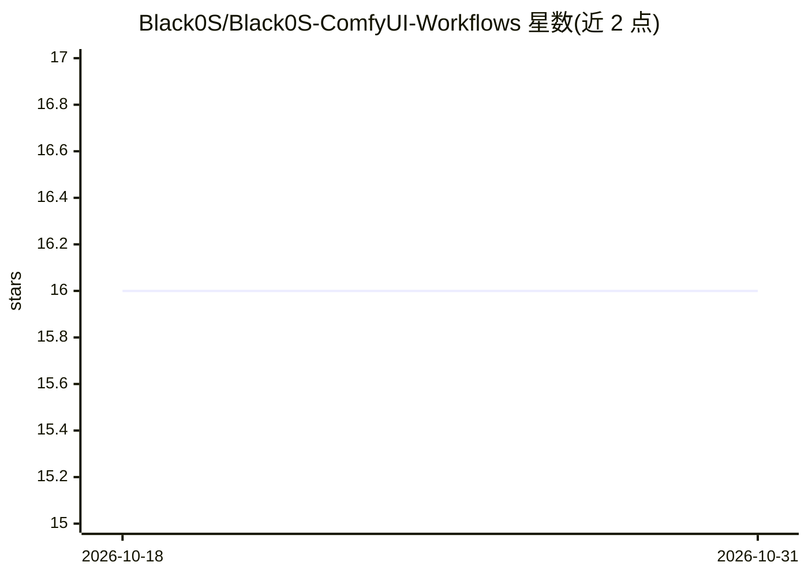

# Black0S/Black0S-ComfyUI-Workflows

⭐ 16 · NOASSERTION · 推送 2026-07-09 · [GitHub](https://github.com/Black0S/Black0S-ComfyUI-Workflows) · 个人维护

**面向 ComfyUI 用户的多模态工作流合集：文生图与语音音乐生成**

作者维护的 ComfyUI 工作流集合（V3），覆盖文生图、图生图、局部重绘/外绘、放大、ControlNet 结构控制的图像流程，以及 VibeVoice/Kokoro 语音生成与 ACE-Step/Checkpoint 音乐生成流程。基于最新 Subgraph 架构组织节点。安装方式为从 Release 下载文件放入 ComfyUI /workflows 目录解压后加载，图像模型兼容 GGUF/SDXL/Pony/Illustrious/SD 1.5-2.x 等，视频与 3D 输出标注为开发中。

## 筛选速览

| 维度 | 判定 | 备注 |
|---|---|---|
| AI 角色 | `ai-native` | 本体是模型或模型工具 |
| 许可风险 | `none` | NOASSERTION |
| 部署形态 | `None` |  |
| 模型依赖 | — | README 未给出锁定关系 |
| 硬件要求 | — | 无带数字的原话,不猜 |
| 安装摩擦 | `low` | 无编译、无系统依赖或容器化 |
| 成熟度 | `idea` | |

## 能力要点

- 图像流程：TXT2IMG/IMG2IMG/重绘外绘/放大/ControlNet 集成
- 音频流程：VibeVoice 与 Kokoro 文本转语音、ACE-Step 音乐生成
- 基于 ComfyUI Subgraph 架构组织，参数全暴露
- 兼容 GGUF(FLUX/QWEN)、SDXL、Pony、Illustrious、SD 1.5/2.x 等模型

## 适用场景

- 在 ComfyUI 中直接加载现成工作流生成图像
- 通过工作流进行文本转语音与 AI 音乐生成
- 专业图像放大与 ControlNet 姿态/深度控制生成

## 场景标签

`图像生成` `语音合成` · 领域:内容生成

## 证据(README 行号)

> L18: V3 represents the latest evolution of my complete ComfyUI workflow system expanding beyond visual generation into a
> L20: Engineered for performance, modularity, and scalability, V3 delivers a production-ready creative pipeline covering 
> L71: |✏️ **Text → Image Generation**|High-fidelity image synthesis from prompts with full exposure of sampling, conditio

## 星数曲线

2026-10-18 16 → 2026-10-31 16（+0）

---
*卡片 v1 · prompt 1.4 · 生成 2026-10-30 · 置信度 high · 依据 README sha `dc9a6f096347` · [字段定义](../../DATASET.md)*
