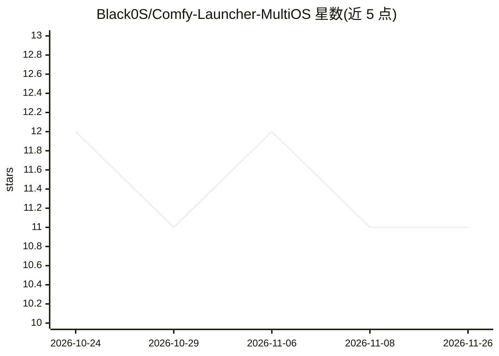

# Black0S/Comfy-Launcher-MultiOS

⭐ 11 · Shell · 推送 2026-07-09 · [GitHub](https://github.com/Black0S/Comfy-Launcher-MultiOS) · 个人维护

**Linux/macOS 上一键安装、启动、更新 ComfyUI 的 Bash 脚本**

单文件交互式 Bash 脚本（comfy.sh），在 Linux 与 macOS 上安装、启动、更新和管理 ComfyUI：自动检测发行版（Fedora/RHEL、Arch、Ubuntu/Debian、macOS），可选择 Python 3.12/3.13/3.14，创建 venv 并按硬件安装对应 PyTorch 后端（Linux CUDA、macOS MPS）。提供本地/局域网/HTTPS 启动模式（自签名证书自动生成）、可保存的启动配置档、Python 版本切换（无需重装）以及系统诊断面板。Arch 上通过 pyenv/AUR 安装多版本 Python。脚本为独立项目，与 ComfyUI 官方无隶属关系。

## 筛选速览

| 维度 | 判定 | 备注 |
|---|---|---|
| AI 角色 | `ai-ecosystem` | LLM/agent 周边工具 |
| 许可风险 | `none` | — |
| 部署形态 | `None` |  |
| 模型依赖 | — | README 未给出锁定关系 |
| 硬件要求 | — | 无带数字的原话,不猜 |
| 安装摩擦 | `medium` | 含编译或系统依赖之一 |
| 成熟度 | — | 结构信号不足 |

## 能力要点

- 单脚本交互菜单覆盖安装/启动/更新/诊断全流程
- 自动检测 OS 并按硬件安装对应 PyTorch 后端（CUDA/MPS）
- 可保存命名启动配置档，一键重启指定地址与 HTTPS 设置
- 不重装即可切换 venv 的 Python 版本

## 适用场景

- 在多种 Linux 发行版和 macOS 上一键部署 ComfyUI
- 在 Tailscale 或局域网中通过保存的配置档远程访问 ComfyUI
- 在不同 Python 版本间切换以兼容不同自定义节点

## 场景标签

`图像生成` · 领域:内容生成

## 证据(README 行号)

> L3: A single Bash script (`comfy.sh`) to install, launch, update, and manage ComfyUI on Linux and macOS — with multi-OS 
> L57: - Clone ComfyUI and ComfyUI-Manager into `./comfyui`

## 星数曲线

2026-10-24 12 → 2026-11-26 11（-1）

---
*卡片 v1 · prompt 1.4 · 生成 2026-11-19 · 置信度 high · 依据 README sha `b918013b7fae` · [字段定义](../../DATASET.md)*
