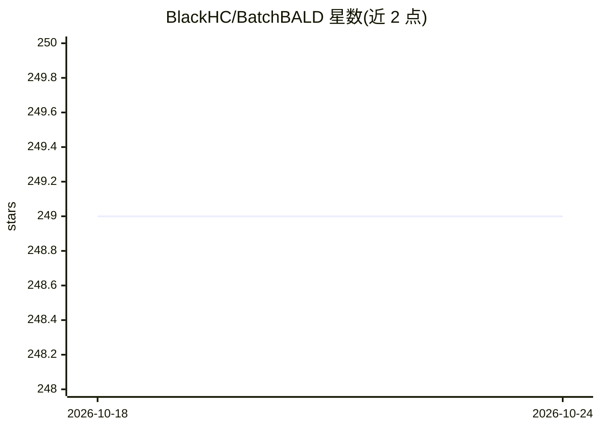

# BlackHC/BatchBALD

⭐ 249 · Python · GPL-3.0 · 推送 2026-04-13 · [GitHub](https://github.com/BlackHC/BatchBALD) · [官网](https://blackhc.github.io/BatchBALD/) · 个人维护

**BatchBALD 论文代码：深度贝叶斯主动学习的批量采集**

论文《BatchBALD: Efficient and Diverse Batch Acquisition for Deep Bayesian Active Learning》的代码发布仓库，实现用于深度贝叶斯主动学习的高效多样化批量采集策略，实验基于 MNIST 数据集与 MC dropout 采样。代码以原样提供，作者指出更模块化的重实现在 batchbald_redux 仓库中，ElementAI 的 Baal 框架也支持 BatchBALD。通过 conda 安装 PyTorch 及 requirements 依赖后运行实验脚本。

## 筛选速览

| 维度 | 判定 | 备注 |
|---|---|---|
| AI 角色 | `ai-native` | 本体是模型或模型工具 |
| 许可风险 | `viral` | GPL-3.0 |
| 部署形态 | `library` | 以包/库形式分发 |
| 模型依赖 | — | README 未给出锁定关系 |
| 硬件要求 | — | 无带数字的原话,不猜 |
| 安装摩擦 | `low` | 无编译、无系统依赖或容器化 |
| 成熟度 | — | 结构信号不足 |

## 能力要点

- 实现 BatchBALD 批量采集算法的论文代码
- 提供基于 MNIST 子集的快速实验入口（run_experiment.py）
- 存在更模块化的重实现 batchbald_redux

## 适用场景

- 复现 BatchBALD 论文实验
- 研究深度贝叶斯主动学习中的批量采集策略
- 参考算法实现进行主动学习研究

## 场景标签

`模型训练` · 领域:训练与推理

## 证据(README 行号)

> L5: This is the code drop for our paper
> L6: BatchBALD: Efficient and Diverse Batch Acquisition for Deep Bayesian Active Learning.

## 星数曲线

2026-10-18 249 → 2026-10-24 249（+0）

---
*卡片 v1 · prompt 1.4 · 生成 2026-10-22 · 置信度 mid · 依据 README sha `d5ef277ec5e9` · [字段定义](../../DATASET.md)*
