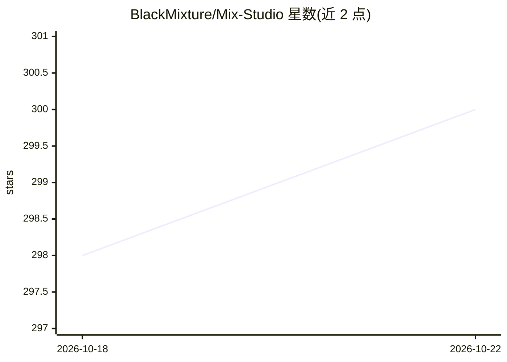

# BlackMixture/Mix-Studio

⭐ 300 · JavaScript · GPL-3.0 · 推送 2026-09-24 · [GitHub](https://github.com/BlackMixture/Mix-Studio) · [官网](https://blackmixture.com) · 个人维护

**基于 ComfyUI 的本地 AI 图像/视频生成工作台**

Mix Studio 是运行在本地浏览器中的 Web 界面，构建并提交 ComfyUI API 图，覆盖文生图、区域提示、图像编辑（多参考、@Image 令牌、局部重绘/外扩）、视频生成、动作迁移、超分与实验性照片转 3D。策展模型族包括 Krea 2、Flux 2 Klein、Qwen Image 2.1、MiniMax H3、LTX 2.3/2.5、Wan 2.2 等。支持桌面与手机同 Wi-Fi 或 Tailscale 访问，复用已有 ComfyUI 安装与模型。限制：NVIDIA 支持最全，Apple Metal 仅兼容子集，AMD ROCm 实验性；LTX 2.5 与 MiniMax H3 部分路线不可用于 Metal/ROCm。

## 筛选速览

| 维度 | 判定 | 备注 |
|---|---|---|
| AI 角色 | `ai-native` | 本体是模型或模型工具 |
| 许可风险 | `viral` | GPL-3.0 |
| 部署形态 | `None` |  |
| 模型依赖 | — | README 未给出锁定关系 |
| 硬件要求 | `gpu-8g` | |
| 安装摩擦 | `low` | 无编译、无系统依赖或容器化 |
| 成熟度 | `idea` | |

## 能力要点

- 桌面与手机共用的触控友好本地生成工作台（Tailscale 远程访问）
- 策展多模型族的图像/视频工作流：区域提示、多参考编辑、动作迁移、超分
- 复用已有 ComfyUI 安装、模型、自定义节点与队列
- 媒体库管理：搜索、档案夹、元数据、回收站、ZIP 导出

## 适用场景

- 本地运行图像与视频生成工作流，不接触节点图
- 用手机在同 Wi-Fi 或 Tailscale 上远程操作家里的生成机器
- 多参考图像编辑与外扩绘图

## 场景标签

`图像生成` `视频生成` `图像视频处理` · 领域:内容生成

## 证据(README 行号)

> L14: Mix Studio is a local web interface that builds and submits ComfyUI API graphs for image generation, regional promp
> L3:  The cleanest, responsive AI workspace. Run curated image and video workflows from your desktop or phone. Built on C

## 星数曲线

2026-10-18 298 → 2026-10-22 300（+2）

---
*卡片 v1 · prompt 1.4 · 生成 2026-10-22 · 置信度 high · 依据 README sha `58ae88cfc3ed` · [字段定义](../../DATASET.md)*
