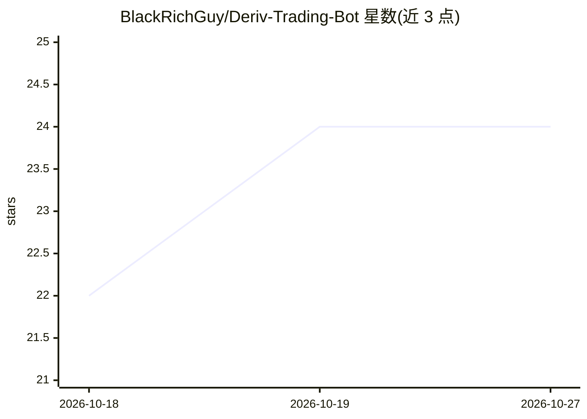

# BlackRichGuy/Deriv-Trading-Bot

⭐ 24 · 推送 2026-09-17 · [GitHub](https://github.com/BlackRichGuy/Deriv-Trading-Bot) · [官网](https://t.me/DerivBinaryAlpha) · 个人维护

**Deriv/DBot 平台免费交易机器人 XML 策略集合**

由个人维护的开源仓库，收录面向 Deriv DBot 平台的免费交易机器人与策略：内容以 XML 文件形式提供，用户注册 Deriv 账号后将 XML 上传至 DBot 平台运行，可调整 Stake、Stop Loss、Take Profit 等参数。README 提及覆盖 Forex、合成指数、加密货币等品种，并声明先在模拟账户测试。实际文件需通过 Telegram 频道获取，仓库内各机器人文件夹另有安装说明。

## 筛选速览

| 维度 | 判定 | 备注 |
|---|---|---|
| AI 角色 | `ai-knowledge` | 知识聚合/清单类 |
| 许可风险 | `none` | — |
| 部署形态 | `None` |  |
| 模型依赖 | — | README 未给出锁定关系 |
| 硬件要求 | — | 无带数字的原话,不猜 |
| 安装摩擦 | `low` | 无编译、无系统依赖或容器化 |
| 成熟度 | — | 结构信号不足 |

## 能力要点

- 以 XML 文件形式提供 DBot 可加载的交易策略
- 使用流程：注册 Deriv → 下载 XML → 上传 DBot → 模拟账户测试
- README 声明覆盖 Forex、合成指数、Crypto 等品种
- 可调参数包括 Stake、Stop Loss、Take Profit

## 适用场景

- 在 Deriv DBot 平台加载现成策略自动交易
- 调整注额与止损止盈参数测试自己的策略
- 获取 Boom/Crash、Even/Odd 等品种的机器人文件

## 场景标签

`金融量化` · 领域:学习与行业

## 证据(README 行号)

> L9: # 👉 Tested Free Deriv Binary Bots, strategies, Classes and Analysistool 2026:
> L24: **3. Download:** Get the XML files from the Bots XML
> L26: **4. Load:** Go to Deriv DBot and upload the XML file.

## 星数曲线

2026-10-18 22 → 2026-10-27 24（+2）

---
*卡片 v1 · prompt 1.4 · 生成 2026-10-27 · 置信度 low · 依据 README sha `a36a2b0d5f8f` · [字段定义](../../DATASET.md)*
